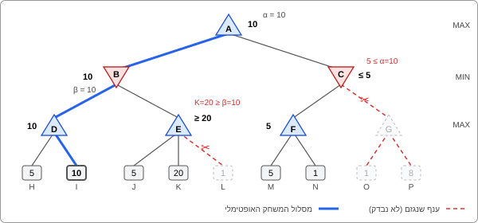
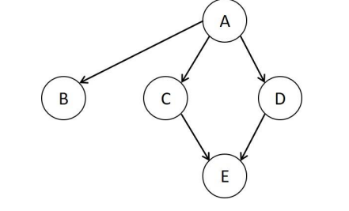

# מבוא לבינה מלאכותית

הקורס עוסק בשאלה אחת: איך סוכן ממוחשב **מחליט מה לעשות**. כמעט כל הנושאים הם וריאציות של אותו רעיון: מגדירים את העולם כ**מצבים**, **פעולות** ו**מטרה**, ואז בוחרים אלגוריתם שמחפש את רצף הפעולות (או את ההשמה, או את המדיניות) הטוב ביותר. ההבדל בין הנושאים הוא מה ידוע לנו על העולם:
- כשהעולם דטרמיניסטי וידוע - **חיפוש** (פרקים 3-4).
- כשיש יריב - **משחקים** (פרק 5).
- כשמחפשים רק השמה שמקיימת אילוצים - **CSP** (פרק 6).
- כשיש אי-ודאות - **הסתברות** (פרקים 13-14) ו-**MDP** (פרק 17).
- כשלומדים מדוגמאות - **עצי החלטה** (פרק 18).

כשקוראים, כדאי לשאול כל הזמן שתי שאלות: _"מה המצב, מה הפעולות ומה המטרה?"_ ו-_"איזה אלגוריתם מתאים כאן, ומה הוא מבטיח (שלמות / אופטימליות)?"_

המבחנים כמעט תמיד בנויים אותו דבר: ניסוח בעיה, הרצה ידנית של אלגוריתם בטבלה, ושאלה "מה צריך להיות הפרמטר כדי ש...". פתרונות מלאים לכל המבחנים 2024-2026 נמצאים ב-[exams.md](exams.md).

## נושאים

<div dir="rtl">

| #   | נושא | תדירות במבחנים (2024-2026, 14 מבחנים) |
| --- | ---- | -------------------------------------- |
| 1 | [ניסוח בעיות חיפוש](#1-ניסוח-בעיות-חיפוש) | כמעט בכל מבחן (חלק משאלות 1-2) |
| 2 | [חיפוש חסר ידע](#2-חיפוש-חסר-ידע) | 5 מבחנים (בחירת אלגוריתם, ציור עץ) |
| 3 | [חיפוש עם ידע ויוריסטיקות](#3-חיפוש-עם-ידע-ויוריסטיקות) | 7 מבחנים |
| 4 | [חיפוש מקומי](#4-חיפוש-מקומי) | 6 מבחנים (כל מבחן מ-2025) |
| 5 | [משחקים: מינימקס וגיזום אלפא-בטא](#5-משחקים-מינימקס-וגיזום-אלפא-בטא) | 11 מבחנים |
| 6 | [בעיות סיפוק אילוצים (CSP)](#6-בעיות-סיפוק-אילוצים-csp) | 7 מבחנים |
| 7 | [הנמקה הסתברותית ורשתות בייסיאניות](#7-הנמקה-הסתברותית-ורשתות-בייסיאניות) | 3 מבחנים |
| 8 | [תהליכי החלטה מרקוביים (MDP)](#8-תהליכי-החלטה-מרקוביים-mdp) | **כל מבחן** (תמיד שאלה 4) |
| 9 | [למידה: עצי החלטה](#9-למידה-עצי-החלטה) | 7 מבחנים |
| 10 | [סוכנים, לוגיקה ותכנון](#10-סוכנים-לוגיקה-ותכנון) | לא הופיע ב-2024-2026 (הופיע במבחנים ישנים) |
| - | [דף נוסחאות](#דף-נוסחאות) | |

</div>

**עמודים חשובים בספר:** 91 (best-first), 95 (A\*), 129 (חיפוש מקומי), 171 (AC-3), 176-177 (backtracking והיוריסטיקות שלו), 196, 199-200 (אלפא-בטא), 437 (D-separation), 558-567 (MDP, Value Iteration בעמ' 563), 677-680 (עצי החלטה ואנטרופיה).

---

## 1. ניסוח בעיות חיפוש

#### במילים פשוטות

לפני שפותרים בעיה צריך לתאר אותה בצורה שמחשב יכול לעבוד איתה. **מצב** הוא "צילום" של כל מה שחשוב בעולם ברגע נתון (למשל באיזה צד של הנהר נמצא כל אחד). **פעולה** משנה מצב אחד למצב אחר. פתרון הוא רצף פעולות מהמצב ההתחלתי למצב מטרה. השאלה הראשונה כמעט בכל מבחן היא "נסחו את הבעיה", והניקוד ניתן על כל רכיב בנפרד. לכן חשוב לכתוב את כולם, גם אם הם נראים מובנים מאליהם.

**רכיבי הבעיה (תמיד לכתוב את כולם):**

- **מרחב המצבים (State space)** - איך מייצגים מצב (וקטור, מטריצה, זוג סדור), ו**כמה מצבים יש**. חסם עליון מספיק, אבל צריך לציין שזה חסם (לא כל המצבים חוקיים/ישיגים).
- **מצב התחלה (Initial state).**
- **מבחן מטרה / מצב סיום (Goal test).**
- **פעולות (Actions)** - בצורה קומפקטית (למשל "כיוון הזזת הרווח", "זוג אינדקסים להחלפה"), ו**גודל מרחב הפעולות**.
- **מודל מעברים (Transition model)** - פונקציה $`s, a \rightarrow s'`$, **כולל התנאים** שבהם הפעולה חוקית. מבקשים לעיתים דוגמה למעבר חוקי ולמעבר לא חוקי.
- **פונקציית מחיר (Cost function)** - מחיר צעד, ומחיר מסלול (סכום מחירי הצעדים).
- **פתרון אופטימלי** - פתרון בעל מחיר מינימלי.
- **הפשטה (Abstraction)** - התייחסות רק לפרטים החשובים. הפשטה טובה מורידה פרטים רבים, ושומרת על כך שלכל פתרון מופשט יש פתרון מפורט.

**מתכון לשאלת ניסוח:**

1. **מצב:** "וקטור/מטריצה של ..., כאשר כל רכיב מציין ...". לבחור ייצוג שיקל על כתיבת מודל המעברים (המבחן אפילו כותב את זה: "הגדירו כך שיסייע לכם עם מודל המעברים").
2. **גודל:** סופרים לפי עקרון הכפל. ביטים: $`2^n`$. סידורים: $`n!`$. בחירת k מתוך n: $`\binom{n}{k}`$. מיקום שחקנים ואז מצב שאר המשבצות: $`25 \cdot 24 \cdot 2^{23}`$.
3. **פעולה:** הצורה הכי קומפקטית (פרמטרים), ואז הגודל (מכפלת טווחי הפרמטרים).
4. **מודל מעברים:** כותבים את התנאים (בתוך הלוח, יש דיסקית, הסירה באותו צד...) ואת השינוי ב-s'. פסאודו-קוד קצר מתקבל:

   ```text
   pos = find(M, 0); newPos = pos + a
   if 1 <= newPos.i <= 3 and 1 <= newPos.j <= 3:
       s' = copy(M); s'[pos] = M[newPos]; s'[newPos] = 0
   ```

5. **מחיר:** מה בדיוק עולה (זמן המעבר האיטי, כמות המים שזזה, 1 לכל צעד).

**דוגמה פתורה - גשר ופנס** ([2024א א1](exams.md#2024א-מועד-א1)). 4 אנשים עם זמנים 1, 2, 5, 6. פנס יחיד, עוברים לבד או בזוג.

<div dir="rtl">

| רכיב | תשובה |
| --- | --- |
| מצב | 5 ביטים: צד של כל אדם + צד הפנס. $`2^5 = 32`$ (חסם עליון) |
| התחלה / מטרה | 00000 / 11111 |
| פעולות | קבוצה של 1-2 אנשים שעוברים: $`4 + \binom{4}{2} = 10`$ |
| מעברים | חוקי רק אם כל הנבחרים באותו צד של הפנס. הופכים את הביטים שלהם ושל הפנס |
| מחיר | המקסימום מבין זמני העוברים |

</div>

הפתרון האופטימלי: {1,2} (2), 1 חוזר (1), {5,6} (6), 2 חוזר (2), {1,2} (2), סה"כ **13**.

**בעיות שחזרו במבחנים:** גשר ופנס / מרוץ לפיד, זאב-עז-כרוב, בעיית הכדים (4 ו-3 ליטר), 8-puzzle, Isolation (בידוד), מנקלה, יניב.

**דפוסי מבחן ומלכודות:**

- **4! = 24**, לא 16. בדקו כל חישוב גודל.
- ‏**8-puzzle:** $`9!`$ מצבים, אבל רק $`9!/2`$ ישיגים מכל מצב (זוגיות). 4 פעולות (כיוון הרווח), לא "כל אריח בכל כיוון".
- **זאב-עז-כרוב:** הסירה תמיד עם האדם, ולכן 4 ביטים (16 מצבים, 10 חוקיים). רק אחת מ-4 הפעולות חוקית במצב ההתחלתי.
- **פעולה מורכבת (Isolation):** צעד **וגם** הסרת דיסקית, ולכן מרחב הפעולות הוא מכפלה: $`8 \cdot 23`$ או $`8 \cdot 25`$.
- **מצב ≠ צומת:** צומת בעץ החיפוש כולל גם את המסלול אליו. ייתכנו כמה צמתים עם אותו מצב.

---

## 2. חיפוש חסר ידע

#### במילים פשוטות

אלגוריתמים שלא יודעים כלום על המטרה חוץ מ"להגיע אליה". הם שונים רק ב**סדר** שבו הם מפתחים צמתים: מי שנמצא הכי קרוב לשורש (BFS), מי שהכי זול להגיע אליו (UCS), או מי שהכי עמוק (DFS). **החזית (frontier)** היא קבוצת הצמתים שנוצרו ועוד לא פותחו, ומבנה הנתונים שלה קובע את האלגוריתם.

**הגדרות:**

- **עץ חיפוש** - השורש הוא המצב ההתחלתי, וכל קשת היא פעולה. **פיתוח צומת** הוא יצירת כל הצמתים העוקבים לו.
- **חיפוש עץ מול חיפוש גרף** - חיפוש גרף שומר קבוצה של מצבים שכבר פותחו (explored set) ולא מפתח אותם שוב. חיפוש עץ לא שומר, ולכן יכול להיכנס ללולאה.
- **שלמות** - מובטח למצוא פתרון אם יש. **אופטימליות** - מובטח למצוא את הזול ביותר.
- ‏b - מקדם סיעוף, d - עומק הפתרון הרדוד ביותר, m - העומק המקסימלי, $`C^*`$ - מחיר הפתרון האופטימלי, ε - מחיר צעד מינימלי.

<div dir="rtl">

| אלגוריתם | החזית | מבחן מטרה | שלם? | אופטימלי? | זמן / מקום |
| --- | --- | --- | --- | --- | --- |
| BFS | תור FIFO | ביצירה | כן (b סופי) | כן, אם כל הצעדים באותו מחיר | $`O(b^d)`$ / $`O(b^d)`$ - המקום הוא הבעיה |
| UCS (מונחה מחיר, Dijkstra) | תור קדימויות לפי $`g(n)`$ | **בפיתוח** | כן (מחיר ≥ ε > 0) | כן | $`O(b^{1+\lfloor C^*/\varepsilon\rfloor})`$ |
| DFS | מחסנית (LIFO) / רקורסיה | ביצירה | גרף סופי - כן. עץ - **לא** (לולאות) | לא | $`O(b^m)`$ / $`O(bm)`$ |
| DLS (מוגבל עומק l) | מחסנית | | לא (אם $`l < d`$) | לא | $`O(b^l)`$ / $`O(bl)`$ |
| IDS (העמקה הדרגתית) | DLS עם l = 0, 1, 2, ... | | כן | כן (מחיר אחיד) | $`O(b^d)`$ / $`O(bd)`$ |
| דו-כיווני | שני BFS, מההתחלה ומהמטרה | נפגשים | כן | כן (מחיר אחיד) | $`O(b^{d/2})`$ - כי $`b^{d/2} + b^{d/2} \ll b^d`$ |

</div>

**פסאודו-קוד:**

כל אלגוריתמי החיפוש הם אותה לולאה, וההבדל הוא רק **באיזה סדר מוציאים צמתים מהחזית**:

```text
generic_search(problem, priority):          # priority decides who leaves the frontier first
    start = Node(problem.initial, parent=None, action=None, g=0)
    frontier = PriorityQueue([start], key=priority)
    best_g = {problem.initial: 0}           # cheapest cost found so far to each state
    while frontier is not empty:
        node = frontier.pop()               # lowest priority value first
        if problem.is_goal(node.state):
            return path_to(node)
        for action in problem.actions(node.state):
            s2 = problem.result(node.state, action)
            g2 = node.g + problem.cost(node.state, action, s2)
            if s2 not in best_g or g2 < best_g[s2]:
                best_g[s2] = g2
                frontier.push(Node(s2, node, action, g2))
    return FAILURE
```

‏UCS = ‏`priority = g`. ‏A\* = ‏`priority = g + h`. חמדני = ‏`priority = h`.

```text
bfs(problem):                               # FIFO queue, goal test when a node is GENERATED
    if problem.is_goal(problem.initial): return [problem.initial]
    frontier = Queue([Node(problem.initial)])
    seen = {problem.initial}
    while frontier is not empty:
        node = frontier.pop_front()
        for action in problem.actions(node.state):
            s2 = problem.result(node.state, action)
            child = Node(s2, node, action)
            if problem.is_goal(s2): return path_to(child)
            if s2 not in seen:
                seen.add(s2)
                frontier.push_back(child)
    return FAILURE

depth_limited(problem, node, limit):        # DFS that stops at depth `limit`
    if problem.is_goal(node.state): return path_to(node)
    if limit == 0: return CUTOFF
    cut = False
    for action in problem.actions(node.state):
        child = Node(problem.result(node.state, action), node, action)
        r = depth_limited(problem, child, limit - 1)
        if r == CUTOFF: cut = True
        elif r != FAILURE: return r
    return CUTOFF if cut else FAILURE

ids(problem):                               # iterative deepening: limit = 0, 1, 2, ...
    for limit in 0, 1, 2, ...:
        r = depth_limited(problem, Node(problem.initial), limit)
        if r != CUTOFF: return r
```

**מתכון - איזה אלגוריתם לבחור? (שאלה חוזרת)**

1. כל הצעדים באותו מחיר ← **BFS** (או IDS אם הזיכרון מוגבל).
2. מחירים שונים ← **UCS**.
3. יש יוריסטיקה קבילה ← **A\***.
4. עומק גדול מאוד וזיכרון מוגבל ← IDS / DFS.

**מתכון - ציור עץ חיפוש לעומק k:**

1. מסדרים את הפעולות בסדר קבוע (השאלה תמיד אומרת להפעיל "בסדר שיטתי").
2. מכל צומת מפעילים רק פעולות **חוקיות**. אם השאלה מבקשת, מדלגים על **חזרה מיידית** (הלוך-חזור) ועל **מצבים שכבר הגענו אליהם** (בעלות קטנה או שווה).
3. על כל קשת כותבים את הפעולה ואת המחיר. בכל צומת כותבים את המצב (ואת g אם צריך).

**דוגמה פתורה - כדים 4 ו-3 ליטר, עלות = כמות המים שזזה** ([2024ב א1](exams.md#2024ב-מועד-א1)). המחירים לא אחידים, ולכן UCS עם תור קדימויות. העץ לעומק 3:

```text
(0,0)
├── fill4 (4) → (4,0)
│   ├── pour4→3 (3) → (1,3) ── empty3 (3) → (1,0)
│   └── fill3 (3) → (4,3)
└── fill3 (3) → (0,3) ── pour3→4 (3) → (3,0) ── fill3 (3) → (3,3)
```

**דפוסי מבחן ומלכודות:**

- ‏**UCS מול BFS:** ב-UCS מבחן המטרה מתבצע **כשמפתחים** צומת, לא כשיוצרים אותו. הצומת הראשון שמגיע למטרה לא בהכרח הזול ביותר. בנוסף, אם נמצא מסלול זול יותר לצומת שכבר בחזית - מעדכנים אותו. אם כל המחירים שווים, UCS זהה ל-BFS, חוץ מזה ש-BFS עוצר כבר כשהמטרה **נוצרת**.
- ‏**DFS בחיפוש עץ עם סדר קבוע** יכול להיתקע בלולאה אינסופית (בגשר ופנס: אדם 1 הולך וחוזר לנצח). זו בדיוק הסיבה ש-DFS על עץ אינו שלם.
- ‏**DFS בלי הלוך-חזור** מוצא פתרון, אבל לא בהכרח אופטימלי (15 במקום 13 בגשר ופנס).
- **הצומת הראשון ש-UCS מפתח** אחרי השורש הוא העוקב עם g מינימלי (בשאלת מרוץ הלפיד: רץ 1 לבד, g = 1).
- חסרונות החיפוש חסר הידע: לא מנצל את מבנה הבעיה, ולא מסתכל על המטרה, ולכן לא יעיל.

---

## 3. חיפוש עם ידע ויוריסטיקות

#### במילים פשוטות

**יוריסטיקה** $`h(n)`$ היא ניחוש מושכל של המחיר שנשאר מהמצב n למטרה ("כמה אריחים לא במקום"). היא לא צריכה להיות מדויקת, אבל אם היא **אף פעם לא מגזימה** (קבילה), אז A\* - שמפתח את הצומת עם $`g + h`$ הקטן ביותר - מובטח למצוא את הפתרון הזול ביותר, ומהר בהרבה מחיפוש עיוור.

**הגדרות:**

- ‏**Best-first search** - מפתחים את הצומת עם ערך מינימלי של פונקציית הערכה $`f(n)`$ (תור קדימויות). UCS הוא best-first עם $`f = g`$.
- **חיפוש חמדני (Greedy)** - $`f(n) = h(n)`$. מהיר, אבל לא אופטימלי, ועלול להיכנס למבוי סתום (ובלי בדיקת כפילויות - לרוץ לנצח).
- ‏**A\*** - $`f(n) = g(n) + h(n)`$. האלגוריתם עצמו כמו UCS, רק עם $`g + h`$. עוצר כש**מפתחים** צומת מטרה. A\* שלם, ולא מפתח צמתים עם $`f > C^*`$.
- **יוריסטיקה קבילה (Admissible) - "אף פעם לא מגזימה".** בכל מצב, הניחוש קטן או שווה למחיר האמיתי של הדרך הזולה ביותר מהמצב למטרה (מסמנים אותו $`h^*(n)`$):

```math
h(n) \le h^*(n)\quad\text{for every state } n
```

  כלומר היוריסטיקה **אופטימית**: היא אומרת "נשאר לפחות כך וכך", ואף פעם לא יותר ממה שבאמת נשאר. בגלל זה A\* לא "מוותר" על הדרך הזולה: הערך $`g+h`$ של צומת על הדרך האופטימלית אף פעם לא גבוה מהמחיר האופטימלי.
- **יוריסטיקה עקבית (Consistent / מונוטונית) - "לא יורדת מהר יותר ממה שמשלמים".** בכל צעד שעולה $`c`$, הניחוש יכול לרדת **לכל היותר** ב-$`c`$:

```math
h(n) - h(n') \le c(n,a,n')\qquad\text{for every step from } n \text{ to } n' \text{ with action } a
```

  ‏(ובנוסף $`h=0`$ במטרה.) אותו דבר בניסוח אחר: $`h(n) \le c(n,a,n') + h(n')`$ — הניחוש ממצב לא יכול להיות גבוה מ"מחיר הצעד הבא ועוד הניחוש מהמצב שאחריו", כמו אי-שוויון המשולש. התוצאה: לאורך כל מסלול הערך $`f=g+h`$ **לא יורד**.
- **הקשר בין השתיים:** כל יוריסטיקה עקבית היא גם קבילה, אבל לא להפך. ‏(עקבית היא התנאי החזק יותר.)

  **דוגמה קטנה שמראה את שלושת המקרים** — גרף $`S`$, $`A`$, $`G`$ (מטרה), עם צעד מ-$`S`$ ל-$`A`$ במחיר 1 וצעד מ-$`A`$ ל-$`G`$ במחיר 1. המחירים האמיתיים: $`h^*(S)=2`$, $`h^*(A)=1`$, $`h^*(G)=0`$.

<div dir="rtl">

| ‏$`h(S)`$ | ‏$`h(A)`$ | קבילה? | עקבית? | למה |
| --- | --- | --- | --- | --- |
| 2 | 1 | כן | כן | שווה למחיר האמיתי; בכל צעד h יורדת ב-1 והצעד עולה 1 |
| 2 | 0 | כן | **לא** | אף ערך לא מגזים, אבל בצעד מ-$`S`$ ל-$`A`$ היא יורדת ב-2 והצעד עולה רק 1 |
| 2 | 5 | **לא** | **לא** | ‏$`h(A)=5`$ גדול מהמחיר האמיתי 1 |

</div>

- **אופטימליות של A\*:**
  - בחיפוש **עץ** - אופטימלי אם h **קבילה**.
  - בחיפוש **גרף** - אופטימלי אם h **עקבית**. (אחרת A\* עלול לא לפתח מחדש צומת שכבר פותח, גם אם עכשיו נמצאה אליו דרך טובה יותר.)
- **דומיננטיות** - אם $`h_2(n) \ge h_1(n)`$ לכל n, ושתיהן קבילות, אז $`h_2`$ **דומיננטית** וטובה יותר: היא מפתחת פחות צמתים. ככל שהיוריסטיקה נותנת ערכים גבוהים יותר (בלי להגזים), מגיעים מהר יותר.
- **יוריסטיקות שמורכבות מכמה יוריסטיקות** - $`\max(h_1, h_2)`$ קבילה ודומיננטית על שתיהן. **$`h_1 + h_2`$ לא בהכרח קבילה!**

**איך ממציאים יוריסטיקה קבילה:**

1. **בעיה מוחלשת (Relaxed problem)** - מורידים אילוצים מהבעיה. המחיר המדויק של הבעיה המוחלשת הוא יוריסטיקה קבילה (וגם עקבית) לבעיה המקורית. היא צריכה להיות ניתנת לחישוב בלי חיפוש. דוגמה ב-8-puzzle:
   - אריח יכול לזוז לכל מקום, ולכן מקבלים "אריחים לא במקום" ($`h_1`$).
   - אריח יכול לזוז לכל משבצת סמוכה, גם אם תפוסה, ולכן מקבלים **מרחק מנהטן** ($`h_2`$, דומיננטית על $`h_1`$).
2. ‏**Pattern databases** - שומרים את המחיר המדויק של תת-בעיות. אם תת-הבעיות זרות (disjoint), אפשר לחבר את המחירים.
3. **למידה מניסיון** - מכלילים מפתרונות אופטימליים.

**חיפוש עם זיכרון מוגבל:**

- ‏**IDA\*** - כמו IDS, אבל החסם הוא על $`f`$ במקום על העומק. החסם ההתחלתי הוא $`h(\text{start})`$, ובכל סבב מגדילים אותו לערך ה-f הקטן ביותר שחרג.
- ‏**RBFS** - DFS רקורסיבי ששומר בכל אב את ה-f של המסלול החלופי הכי טוב. אם הצומת הנוכחי חורג, נסוגים ומעדכנים את הערכים באבות. יעיל יותר מ-IDA\*, אבל מפתח צמתים פעמים רבות.
- ‏**SMA\*** - A\* עד שהזיכרון מתמלא. אז זורקים את העלה **הגרוע ביותר** (הישן ביותר בשוויון), ושומרים את הערך שלו אצל האב. שלם ואופטימלי (אם הפתרון נכנס בזיכרון).

**פסאודו-קוד - A\*:** זו הלולאה הכללית מפרק 2 (`generic_search`) עם עדיפות $`g + h`$. הנקודות שחשובות במבחן:

```text
a_star(problem, h):
    return generic_search(problem, priority = lambda node: node.g + h(node.state))
    # - the goal test happens when a node is POPPED (not when generated) -> optimal
    # - a state is pushed again if a cheaper path to it was found (g2 < best_g[s2])
    # - tie on f: usually the smaller h (or the order the question gives)
```

**מתכון - להוכיח שיוריסטיקה קבילה:**

1. **מה h סופרת?** מנסחים במילים: "h = מספר האנשים שעוד לא עברו", "h = סכום מרחקי מנהטן".
2. **למה הדרך האמיתית חייבת לשלם לפחות את זה?** מוצאים את הסיבה שכל "יחידה" ש-h סופרת דורשת תשלום: "כל אדם שנשאר חייב לעבור לפחות פעם אחת, וכל מעבר עולה לפחות 1 לכל אדם שעובר בו".
3. **מסקנה:** בכל מצב המחיר האמיתי גדול או שווה ל-h, ולכן h קבילה.

‏(דרך קיצור: אם h היא המחיר המדויק של **בעיה מוחלשת** — אותה בעיה עם פחות אילוצים — היא קבילה ועקבית אוטומטית.)

**מתכון - להוכיח שיוריסטיקה עקבית:**

1. רושמים את **כל סוגי הפעולות** (למשל: אדם אחד עובר, שניים עוברים, מישהו חוזר).
2. לכל סוג רושמים בטבלה: **בכמה h יורדת** בפעולה, ו**מה המחיר המינימלי** של הפעולה.
3. מראים שבכל שורה הירידה קטנה או שווה למחיר. אם h **עולה** או לא משתנה (למשל כשמישהו חוזר), הירידה שלילית או 0, והתנאי מתקיים מיד.
4. מוודאים ש-h של המטרה היא 0.

**מתכון - להפריך:** מספיקה דוגמה אחת.
- **לא קבילה:** מצב אחד שבו h גדולה מהמחיר האמיתי (מחשבים את הדרך הזולה ממנו ומראים שהיא זולה יותר מ-h).
- **לא עקבית:** צעד אחד שבו h יורדת **יותר** ממחיר הצעד.

**דוגמה פתורה 1 - גשר ופנס** ([2024ב א1](exams.md#2024ב-מועד-א1)): ‏h = **מספר האנשים שעוד לא עברו**. מחיר מעבר = הזמן של האיטי מבין העוברים (כל זמן הוא לפחות 1).

- **קבילה:** כל אדם שנשאר חייב לעבור לפחות פעם אחת. מעבר של אדם אחד עולה לפחות 1; מעבר של שניים עולה לפחות 2 (הזוג המהיר ביותר הוא 1 ו-2). לכן בכל מעבר משלמים לפחות 1 על כל אדם שעובר, והמחיר האמיתי לפחות מספר האנשים שנשארו.
- **עקבית:**

<div dir="rtl">

| פעולה | בכמה h יורדת | מחיר מינימלי | מתקיים? |
| --- | --- | --- | --- |
| אדם אחד עובר | 1 | 1 | כן (1 ≤ 1) |
| שניים עוברים | 2 | 2 | כן (2 ≤ 2) |
| אדם חוזר עם הפנס | ‏1- (h עולה) | 1 | כן, תמיד |

</div>

- **יוריסטיקה חזקה יותר:** h = **הזמן של האיטי ביותר מבין אלה שנשארו**. קבילה: הוא חייב לעבור, ומעבר שלו עולה לפחות את הזמן שלו. עקבית: h יורדת רק כשהאיטי ביותר עובר, היא יורדת לכל היותר בזמן שלו, והמעבר עולה לפחות את הזמן שלו. היא **דומיננטית** (גבוהה יותר או שווה בכל מצב), ולכן A\* יפתח פחות צמתים.

**דוגמה פתורה 2 - מרחק מנהטן ב-8-puzzle:** ‏h = סכום המרחקים (שורות + עמודות) של כל אריח ממקומו במטרה.

- **קבילה:** כל צעד מזיז אריח אחד במשבצת אחת, ולכן מקטין את הסכום ב-1 לכל היותר. כדי להגיע למטרה צריך לפחות h צעדים.
- **עקבית:** כל צעד משנה את h בדיוק ב-1 (למעלה או למטה), ועולה 1.

**דוגמה פתורה 3 - לחשב את מרחק מנהטן** ([2025ב א1](exams.md#2025ב-מועד-א1)). מטרה: `_12/345/678`. מצב: `14_/582/367`.

<div dir="rtl">

| אריח | 1 | 2 | 3 | 4 | 5 | 6 | 7 | 8 |
| --- | --- | --- | --- | --- | --- | --- | --- | --- |
| מקום נוכחי ← מטרה | (1,1)←(1,2) | (2,3)←(1,3) | (3,1)←(2,1) | (1,2)←(2,2) | (2,1)←(2,3) | (3,2)←(3,1) | (3,3)←(3,2) | (2,2)←(3,3) |
| מרחק | 1 | 1 | 1 | 1 | 2 | 1 | 1 | 2 |

</div>

‏**h = 10** ("אריחים לא במקום" נותן 8 ≤ 10, כלומר מנהטן דומיננטית).

**דפוסי מבחן ומלכודות:**

- **"איך יודעים אם היוריסטיקה קבילה?"** משווים ל-BFS (שאופטימלי כשהמחיר אחיד): אם **לכל קלט** אורך המסלול של A\* שווה לזה של BFS, היוריסטיקה מתנהגת כקבילה. אם בקלט **אחד** A\* מצא מסלול ארוך יותר, היא **לא קבילה** (בחיפוש עץ), או לפחות **לא עקבית** (בחיפוש גרף).
- **הערך המקסימלי של מנהטן** ב-8-puzzle: חסם נאיבי $`8 \cdot 4 = 32`$. לפי מקומות המטרה (פינה עד 4, צלע עד 3, מרכז עד 2) החסם הוא 26, והמקסימום בפועל הוא **22**.
- ‏**$`h_1 + h_2`$ של שתי יוריסטיקות קבילות לא בהכרח קבילה:** במצב שנמצא צעד אחד מהמטרה, $`1 + 1 = 2 > 1`$.
- **יוריסטיקת 0** קבילה ועקבית, אבל הופכת את A\* ל-UCS. בדרך כלל שואלים על יוריסטיקה שאינה 0.
- היוריסטיקה החזקה יותר עבור בעיה עם אנשים/פריטים: "הזמן המקסימלי מבין מה שנשאר" (גם האיטי ביותר חייב לעבור) - דומיננטית על "כמה נשארו".

---

## 4. חיפוש מקומי

#### במילים פשוטות

לפעמים לא מעניין **איך** מגיעים לפתרון, רק **מהו** (8 מלכות, ריבוע קסם, מערכת שעות). אז מתחילים ממצב מלא כלשהו ("כל הכלים על הלוח, רק אולי לא במקום"), ובכל צעד עוברים למצב שכן שמשפר את **פונקציית המטרה**. זה כמו לטפס על גבעה בערפל: רואים רק את הצעד הבא. בזיכרון שומרים רק את המצב הנוכחי, ולכן זה מתאים לבעיות ענקיות. המחיר: אפשר להיתקע במינימום מקומי.

**הגדרות:**

- ‏**Complete-state formulation** - כל מצב הוא פתרון מועמד מלא. פעולה משנה אותו מעט (החלפה, הזזה).
- **פונקציית מטרה (Objective function)** - מספר שמודד כמה המצב רחוק מפתרון. במבחנים **מחפשים מינימום** (0 = פתרון).
- **טיפוס גבעה (Hill climbing)** - עוברים לשכן הטוב ביותר. נתקע ב:
  - **מקסימום/מינימום מקומי** - כל השכנים גרועים יותר.
  - **מישור (plateau)** - כל השכנים שווים.
  - **רכס (ridge).**
- **וריאציות:**
  - **צעדים צדדיים** - מותר לעבור לשכן שווה, מספר מוגבל של פעמים.
  - **סטוכסטי** - בוחר שכן משפר באקראי.
  - **בחירה ראשונה (first-choice)** - מייצר שכנים באקראי עד שנמצא אחד שמשפר. טוב כשיש הרבה שכנים. (שתי הווריאציות האלה אינן שלמות.)
  - **עם התחלה אקראית (random restart)** - שלם בהסתברות ששואפת ל-1.
- ‏**Simulated annealing** - בוחרים שכן אקראי. אם הוא משפר, עוברים אליו. אם לא, עוברים בהסתברות $`e^{\Delta E / T}`$, כאשר הטמפרטורה T יורדת בהדרגה. בהתחלה "מקפצים", ובסוף מטפסים.
- ‏**Local beam search** - מחזיקים k מצבים במקביל, ובכל צעד בוחרים את k הטובים מכל השכנים.
- **אלגוריתם גנטי** - אוכלוסייה של מצבים. הבחירה לפי fitness, אחריה הצלבה (crossover) ומוטציה.

**פסאודו-קוד:** (כאן f היא פונקציית מטרה **שממזערים**; בבעיית מקסימום הופכים את הסימנים.)

```text
hill_climbing(start, f):
    current = start
    loop:
        best = neighbor of current with the lowest f      # or: the FIRST neighbor that improves
        if f(best) >= f(current):
            return current                                 # local minimum (or plateau)
        current = best

simulated_annealing(start, f, schedule):
    current = start
    for t = 1, 2, 3, ...:
        T = schedule(t)                                    # temperature, goes down over time
        if T == 0: return current
        nxt = random neighbor of current
        delta = f(current) - f(nxt)                        # > 0 means nxt is better
        if delta > 0 or random() < exp(delta / T):
            current = nxt                                  # worse moves allowed with prob. e^(delta/T)
```

**מתכון לשאלת חיפוש מקומי (המבנה הקבוע במבחנים):**

1. **גודל מרחב המצבים** - כמה סידורים/בחירות יש: $`n!`$, $`\binom{n}{k}`$, $`4^4`$ וכו'.
2. **פונקציית המטרה** - סכום של "מרחקים מהדרישה", בערך מוחלט:

   ```math
   f(s) = \sum_{\text{constraints}} \left| \text{actual}_i - \text{target}_i \right|
   ```

   אם יש שני רכיבים שונים בגודלם (מכפלה מול סכום), **מנרמלים** אותם כך שיהיו מאותו סדר גודל. אחרת החיפוש מתעלם מהרכיב הקטן. שתי גישות:
   - לפי ערך המטרה: $`\frac{|\prod x_i - 448|}{448} + \frac{|\sum y_i - 33|}{33}`$
   - לפי הסטייה המקסימלית האפשרית: $`\frac{|\prod x_i - 448|}{29{,}792} + \frac{|\sum y_i - 33|}{18}`$

   דוגמה רעה: $`|x - 10| + |x! - 20|`$ - הרכיב השני שולט לגמרי.

3. **מרחב הפעולות** - החלפת שניים: $`\binom{n}{2}`$. העברת פריט ממקום למקום: (פריטים) × (מקומות פנויים). החלפה בין קבוצות: $`5 \cdot 5`$.
4. **סימולציה:** מחשבים את f של המצב, עוברים על הפעולות **לפי הסדר השיטתי שבשאלה**, ובוחרים לפי ההוראה:
   - "הנמוך ביותר" - בודקים את כולן.
   - "קטן מהקודם (לא בהכרח הנמוך)" - לוקחים את **הראשונה** שמשפרת.

   כותבים בכל שלב את הפעולה, את המצב ואת f.
5. **גרף פונקציית המטרה** - ציר x: מצבים, ציר y: f. בטיפוס גבעה יוצאת ירידה מונוטונית, ואז שטוח במינימום מקומי.

**דוגמה פתורה - הסוכן הנוסע** ([2025א מועד ב](exams.md#2025א-מועד-ב)). 4 ערים, מסלול פתוח, f = סכום המרחקים, פעולה = החלפת שני אינדקסים ($`\binom{4}{2} = 6`$).

<div dir="rtl">

| a | מ-ABCD (9) | f | מ-ADCB (7) | f |
| --- | --- | --- | --- | --- |
| (1,2) | BACD | 8 | **DACB** | **6** |
| (2,4) | **ADCB** | **7** | ABCD | 9 |
| ...שאר הפעולות | | ≥ 10 | | ≥ 9 |

</div>

‏ABCD (9) → ADCB (7) → DACB (6), ואז אין שיפור. ה-f יורד מונוטונית: 9 ← 7 ← 6.

**דוגמה פתורה - 4 מלכות** ([2025א א1](exams.md#2025א-מועד-א1)). מצב: שורת המלכה בכל עמודה ($`4^4 = 256`$). f = סכום על כל מלכה של מספר המלכות שמאיימות עליה, כלומר פעמיים מספר הזוגות המאיימים. מצב האלכסון (1,2,3,4) שווה $`4 \cdot 3 = 12`$.

**דפוסי מבחן ומלכודות:**

- **4 מלכות - למה סוכמים לכל מלכה?** גם מלכות שלא מאוימות ישירות מהוות מצב שלילי: אם המלכה באמצע תזוז, עדיין יהיה איום בין המלכות בצדדים. לא סופרים עמודות, כי בכל עמודה יש מלכה אחת.
- **שוויון בין פעולות:** ההוראות קובעות סדר עדיפויות (מלכה שמאלית קודם, שורה גבוהה קודם). טעות נפוצה היא לבחור פעולה אחרת עם אותו ערך.
- **"אל תזיזו את אותה מלכה/דיסקית פעמיים ברצף"** - מונע מעבר חזרה למצב הקודם.
- **הבדל מחיפוש רגיל:** בחיפוש רגיל מחפשים גם את **הדרך**. בחיפוש מקומי - רק את **המצב הסופי**.
- **ריבוע/משולש קסם:** צריך את שני הרכיבים (שורות **וגם** עמודות, או כל הצלעות). אל תשכחו חלק.

---

## 5. משחקים: מינימקס וגיזום אלפא-בטא

#### במילים פשוטות

במשחק יש יריב שמנסה להזיק לנו. לכן לא מספיק למצוא מסלול טוב - צריך להניח שבכל תור היריב יבחר את הגרוע ביותר עבורנו. **מינימקס** עובר על עץ המשחק מלמטה למעלה: בתור שלנו (MAX) לוקחים מקסימום, בתור היריב (MIN) מינימום. **אלפא-בטא** נותן את אותה תשובה בדיוק, אבל מדלג על ענפים שכבר ברור שאף שחקן לא יבחר בהם.

**הגדרות - משחק כבעיית חיפוש:**

- מצב התחלתי, **שחקן** (של מי התור), פעולות, מודל מעברים, **מבחן סיום**, ו**פונקציית תועלת** (בהינתן מצב סופי ושחקן).
- **משחק סכום אפס** - סכום התועלות של השחקנים זהה בכל תוצאה (ניצחון של אחד = הפסד של השני).
- **ערך מינימקס:**

```math
\text{MINIMAX}(s) = \begin{cases} \text{UTILITY}(s) & \text{מצב סיום} \\ \max_a \text{MINIMAX}(\text{RESULT}(s,a)) & \text{תור MAX} \\ \min_a \text{MINIMAX}(\text{RESULT}(s,a)) & \text{תור MIN} \end{cases}
```

- **סיבוכיות:** זמן $`O(b^m)`$, ולכן במשחקים אמיתיים חותכים בעומק מסוים ומשתמשים ב**פונקציית הערכה**.
- **משחק עם יותר משני שחקנים** - כל צומת מחזיק וקטור ערכים (אחד לכל שחקן).
- **α** - הערך הטוב ביותר ש-MAX כבר מובטח לו במסלול (חסם תחתון). **β** - הערך הטוב ביותר ש-MIN כבר מובטח לו (חסם עליון).

**פסאודו-קוד:**

```text
minimax_value(state):
    if game.is_terminal(state): return game.utility(state)         # value for MAX
    values = [minimax_value(game.result(state, a)) for a in game.actions(state)]
    return max(values) if game.to_move(state) == MAX else min(values)

best_move(state):                                                  # MAX picks the child with the best value
    return argmax over a in game.actions(state) of minimax_value(game.result(state, a))

alphabeta(state, alpha, beta):     # alpha = best MAX already has, beta = best MIN already has
    if game.is_terminal(state): return game.utility(state)
    if game.to_move(state) == MAX:
        v = -infinity
        for a in game.actions(state):
            v = max(v, alphabeta(game.result(state, a), alpha, beta))
            if v >= beta: return v          # prune: MIN above will never let us get here
            alpha = max(alpha, v)
        return v
    else:
        v = +infinity
        for a in game.actions(state):
            v = min(v, alphabeta(game.result(state, a), alpha, beta))
            if v <= alpha: return v         # prune: MAX above already has something better
            beta = min(beta, v)
        return v

# first call: alphabeta(root, -infinity, +infinity)
```

**מתכון - אלפא-בטא ביד:**

1. מתחילים בשורש עם $`\alpha = -\infty, \beta = +\infty`$. (אם טווח התועלות ידוע מראש, אפשר להתחיל ממנו, למשל $`[-1, 1]`$.)
2. יורדים לעומק משמאל לימין. **α ו-β עוברים מהאב לבן.**
3. **בצומת MAX:** אחרי כל בן, $`v = \max(v, \text{child})`$. אם $`v \ge \beta`$, **גוזמים** את שאר הבנים (MIN שמעל לא יאפשר להגיע לכאן). אחרת $`\alpha = \max(\alpha, v)`$.
4. **בצומת MIN:** $`v = \min(v, \text{child})`$. אם $`v \le \alpha`$, **גוזמים**. אחרת $`\beta = \min(\beta, v)`$.
5. הערך עולה לאב. כותבים ליד כל צומת את (α, v, β), ומסמנים את הענפים הגזומים.

**דוגמה פתורה** ([2024א מועד ב](exams.md#2024א-מועד-ב)). A (MAX) → B, C (MIN) → D, E, F, G (MAX). העלים: D: 5, 10 | E: 5, 20, 1 | F: 5, 1 | G: 1, 8.



<div dir="rtl">

| שלב | הצומת | ‏α ו-β כשנכנסים | מה קורה | גיזום? |
| --- | --- | --- | --- | --- |
| 1 | ‏D ‏(MAX, בן ראשון של B) | ‏$`\alpha=-\infty`$, ‏$`\beta=+\infty`$ — עדיין אין לאף אחד הבטחה | ‏D רואה את העלים 5 ואחר כך 10, ולוקח את הגדול: **D = 10**. עכשיו B (שהוא MIN) יודע שהוא יכול להבטיח לעצמו לכל היותר 10, ולכן $`\beta=10`$ אצל B | לא |
| 2 | ‏E ‏(MAX, בן שני של B) | ‏$`\alpha=-\infty`$, ‏$`\beta=10`$ — ‏B כבר יכול להשיג 10 | ‏E רואה את 5, ואז את 20. עכשיו E שווה **לפחות 20**, אבל B (‏MIN) כבר יכול להשיג 10, ולכן B לעולם לא יבחר את E | **כן — לא בודקים את העלה L.** כל ערך שיופיע שם רק יגדיל את E, ו-B ממילא לא יבחר בו |
| 3 | ‏B ‏(MIN) | — | ‏B לוקח את הקטן מבין D=10 ו-E (שהוא לפחות 20): **B = 10**. עכשיו בשורש A (‏MAX) יש הבטחה ל-10, ולכן $`\alpha=10`$ | — |
| 4 | ‏F ‏(MAX, בן ראשון של C) | ‏$`\alpha=10`$, ‏$`\beta=+\infty`$ — ‏A כבר יכול להשיג 10 | ‏F רואה את 5 ואת 1, ולוקח את הגדול: **F = 5**. עכשיו C (‏MIN) שווה **לכל היותר 5** | — |
| 5 | ‏C ‏(MIN) | ‏$`\alpha=10`$, ‏$`\beta=5`$ | ‏C ייתן ל-A לכל היותר 5, אבל A כבר יכול להשיג 10 דרך B, ולכן A לעולם לא יבחר את C | **כן — לא בודקים את G ואת כל העלים שלו (O, P).** גם אם G יהיה גבוה, ‏C (‏MIN) יבחר ב-F |

</div>

ערך המשחק: **10**. המסלול: ‏A בוחר ב-B, ‏B בוחר ב-D, ו-D בוחר בעלה I.

**הכלל בקיצור:** גוזמים כשההבטחה של צומת כבר **גרועה** ממה שהיריב שמעליו יכול להשיג בדרך אחרת. בצומת MAX זה קורה כשהערך שלו מגיע ל-β או עובר אותו; בצומת MIN — כשהערך שלו יורד ל-α או מתחתיו.

**פונקציית הערכה (Evaluation function):**

- מחזירה הערכה של מצב שאינו סופי, מנקודת המבט של שחקן. הערך צריך להיות **בין ערך ההפסד לערך הניצחון**, ולהתאים לסדר ההעדפות.
- **צורה נפוצה:**

```math
H(s) = \frac{x}{x+y} \quad\text{או}\quad \frac{x - y}{x + y}
```

  כאשר x הוא "כמה טוב לי" ו-y הוא "כמה טוב ליריב". למשל, מספר הצעדים האפשריים של כל שחקן ב-Isolation, או $`\frac{S_1 - S_2}{24}`$ במנקלה.
- **איקס-עיגול:** (מספר הקווים הפתוחים לי) פחות (מספר הקווים הפתוחים ליריב). קו פתוח הוא קו בלי סימן של היריב. אם ליריב יש שניים ברצף והשלישי פנוי, הערך -∞ (חייבים לחסום).
- **מתכון:** כתבו נוסחה, הסבירו מה x ו-y, **וחשבו את הערך על שני המצבים שבשאלה**. ודאו שהמצב הטוב יותר מקבל ערך גבוה יותר.

**דפוסי מבחן ומלכודות:**

- **האם אלפא-בטא יכול לגזום ענף במסלול האופטימלי?** **לא.** אלפא-בטא מחזיר תמיד את אותו ערך ואותה החלטה כמו מינימקס. ענף נגזם רק כשמוכח שהשחקן שמעליו לא יבחר בו.
- **גיזום אופטימלי** - כשהבנים מסודרים מהטוב לגרוע. אז הזמן הוא $`O(b^{m/2})`$.
- **מידע נוסף שמאפשר יותר גיזום:** טווח התועלות. אם ידוע שהערך המקסימלי הוא 1, ברגע ש-MAX מוצא 1 - גוזמים את השאר. אם ידוע ש-MAX לא יכול לנצח, אחרי שמצא תיקו - עוצרים.
- **סימטריה:** באיקס-עיגול מדלגים על מהלכים סימטריים (שיקוף/סיבוב). מסמנים מהלכים כפויים ("חייבים לחסום") כמהלך יחיד.
- **משחק חציית הכמות (המחזיק ב-0 מנצח):** מחשבים מלמטה: 0 - מנצח, 1 - מפסיד, 2 - מנצח, 3 - מנצח, 4 - מפסיד. אם מצב מופיע בעומק אי-זוגי בעץ אחר, "המחזיק" הוא השחקן השני, ולכן התוצאה מתהפכת.
- **אילו עקרונות של משחק סטנדרטי מופרים (יניב, קלפים)?** **ידיעה מלאה** (קלפים מוסתרים) ו**דטרמיניסטיות** (משיכה מהקופה). מצב של שחקן כולל רק מידע שהוא **יודע**: הקלפים שלו, קלפים ידועים של היריב, והערימה הגלויה.
- **עומק העץ ומקדם הסיעוף:**
  - ‏Isolation: עומק לכל היותר 23 (דיסקית אחת יורדת בכל תור).
  - מנקלה: מקדם סיעוף 3 (בחירת גומה).
  - איקס-עיגול: לכל היותר 9 פעולות.

---

## 6. בעיות סיפוק אילוצים (CSP)

#### במילים פשוטות

ב-CSP לא מחפשים מסלול, אלא **השמה**: ערך לכל משתנה, כך שכל האילוצים מתקיימים (Clue: מי, באיזה חדר, באיזה כלי). היתרון על פני חיפוש רגיל: אפשר **לפסול חלקים שלמים** ממרחב החיפוש לפני שנכנסים אליהם (אם $`x_1 < x_2`$ ו-$`x_2 \le 3`$, ברור ש-$`x_1 \ne 3`$), ולהבין למה הם נפסלו.

**הגדרות:**

- **בעיה:** קבוצת משתנים X, תחום לכל משתנה D, קבוצת אילוצים C.
- **השמה** - חלקית או **מלאה** (כל המשתנים). **עקבית** - לא מפרה אף אילוץ. **פתרון = השמה מלאה ועקבית.**
- **סוגי אילוצים:** אונרי (משתנה אחד), בינארי (שניים), גלובלי / n-ארי (כמו AllDiff). אפשר לתת אילוצים רכים עם מחיר.
- **גרף אילוצים** - צמתים = משתנים, קשתות = אילוצים בינאריים (עם תווית של האילוץ).
- **עקביות צומת** - כל ערך בתחום מקיים את האילוצים האונריים.
- **עקביות קשת** - $`X \rightarrow Y`$ עקבית אם **לכל** ערך של X יש ערך **כלשהו** של Y שמקיים את האילוץ.
- **עקביות מסלול / k-עקביות** - לכל השמה עקבית ל-k-1 משתנים יש ערך עקבי למשתנה ה-k. **k-עקביות חזקה** - k-עקבי לכל j ≤ k. יקר מאוד בזמן ובמקום.

**פסאודו-קוד:**

```text
ac3(csp):
    queue = all directed arcs (X, Y) such that X and Y share a constraint
    while queue is not empty:
        (X, Y) = queue.pop()
        if revise(csp, X, Y):                      # did X's domain shrink?
            if domain(X) is empty: return False    # no solution
            for Z in neighbors(X) except Y:
                queue.add((Z, X))                  # Z may have lost its support in X
    return True

revise(csp, X, Y):
    removed = False
    for x in domain(X):
        if there is no y in domain(Y) that satisfies the constraint between X=x and Y=y:
            delete x from domain(X)
            removed = True
    return removed

backtracking(assignment, csp):
    if assignment is complete: return assignment
    X = pick an unassigned variable                  # MRV: the one with the fewest legal values
    for x in order the values of X:                  # LCV: least constraining value first
        if x is consistent with assignment:
            assignment[X] = x
            (optional) run inference, e.g. forward checking or ac3; undo it on failure
            result = backtracking(assignment, csp)
            if result != FAILURE: return result
            remove X from assignment
    return FAILURE
```

**מתכון - AC-3 בטבלה (שאלה כמעט קבועה):**

1. **משתנים ותחומים** - בוחרים ייצוג נוח (למשל x, y לכל פריט, או חשוד/כלי/חדר).
2. **אונריים** - מוחקים מהתחומים לפני AC-3, וכותבים את התחומים שנותרו.
3. **אילוצים בינאריים** - כותבים מתמטית ($`x_1 < x_2`$, $`2x_2 \le x_3`$), ומציירים גרף.
4. **התור** - כל הקשתות, **בשני הכיוונים** (קשתות מכוונות). אילוץ בינארי אחד = 2 קשתות.
5. **לכל קשת (X, Y) שמוציאים מהתור** - לכל ערך של X בודקים אם יש לו "תומך" ב-Y. אם אין, מוחקים אותו. **אם התחום של X השתנה**, מחזירים לתור את כל הקשתות $`(Z, X)`$, חוץ מ-$`(Y, X)`$.
6. ממשיכים עד שהתור ריק. אם תחום התרוקן - אין פתרון.

<div dir="rtl">

| # | קשת | תחום X | תחום Y | האילוץ | הוסר מ-X | נשאר ב-X | חוזר לתור |
| --- | --- | --- | --- | --- | --- | --- | --- |
| 1 | $`(X_1,X_2)`$ | 6,7,8,9 | 6,7,8 | $`X_1 > X_2`$ | 6 (אין $`X_2 < 6`$) | 7,8,9 | $`(X_3,X_1)`$ (כל שכן אחר של $`X_1`$) |

</div>

(דוגמה מלאה בהמשך.)

‏**Backtracking search (עמ' 176):**

- ‏DFS על השמות: בכל רמה בוחרים **משתנה אחד** ומנסים את הערכים שלו. אם תחום מתרוקן, **חוזרים אחורה**.
- **סריקה לעומק:** כל הפתרונות נמצאים באותו עומק (מספר המשתנים), ולכן אין טעם ב-BFS. DFS חוסך זיכרון.
- **בחירת משתנה (דינמית):**
  - ‏**MRV (Minimum Remaining Values)** - המשתנה עם הכי מעט ערכים ("fail-first"). דוגמה: קודם קובעים את זמן הטיסה שיש לו רק 2 אפשרויות.
  - ‏**Degree heuristic** - שובר שוויון ב-MRV: המשתנה שמעורב בהכי הרבה אילוצים עם משתנים שעוד לא הושמו. דוגמה: קודם בודקים מתי פנוי האדם הכי עסוק, או מתחילים מקודקוד במשולש (שני אילוצים) ולא מאמצע צלע.
- **בחירת ערך:** **LCV (Least Constraining Value)** - הערך שמוחק הכי מעט ערכים מהשכנים ("fail-last"). דוגמה: חופשה בחורף, כשאין עומס.
- ‏**Forward checking / פעפוע אילוצים** - אחרי כל השמה מצמצמים את התחומים של השכנים (או מריצים AC-3, ואז זה MAC). אם נשאר ערך יחיד, הוא בעצם הושם. זה **מקטין את עומק העץ באותו ענף**. אם נשארו 0 ערכים, פוסלים את הענף.
- **חיפוש מקומי ל-CSP - min-conflicts:** מתחילים מהשמה מלאה, ובכל צעד בוחרים משתנה בקונפליקט ומשנים אותו לערך שממזער את מספר האילוצים המופרים.

**דוגמה פתורה - הזמנה במסעדה** ([2024ב מועד ב](exams.md#2024ב-מועד-ב)). $`x_1`$ (ראשונה), $`x_2`$ (עיקרית), $`x_3`$ (קינוח). אחרי האונריים: $`x_1 \in \{1,2,5\}`$, $`x_2 \in \{1..5\}`$, $`x_3 \in \{1,3,5,7\}`$. אילוצים: $`x_1 < x_2,\ 2x_2 \le x_3`$.

<div dir="rtl">

| # | קשת | אילוץ | הוסר | נשאר | חוזר לתור |
| --- | --- | --- | --- | --- | --- |
| 1 | $`(x_1,x_2)`$ | $`x_1 < x_2`$ | 5 | {1,2} | - |
| 2 | $`(x_2,x_1)`$ | $`x_1 < x_2`$ | 1 | {2,3,4,5} | $`(x_3,x_2)`$ |
| 3 | $`(x_2,x_3)`$ | $`2x_2 \le x_3`$ | 4, 5 | {2,3} | $`(x_1,x_2)`$ |
| 4 | $`(x_3,x_2)`$ | $`2x_2 \le x_3`$ | 1, 3 | {5,7} | - |
| 5 | $`(x_1,x_2)`$ | | - | {1,2} | התור ריק |

</div>

**דוגמה פתורה - Backtracking במשולש** ([2026א א1](exams.md#2026א-מועד-א1)). סכום כל צלע 30, המספרים {0,5,5,10,20,25}. מתחילים בקודקוד (Degree), וסורקים ערכים מהגדול לקטן:

```text
A=25 → C=5 ✗ (ל-F אין ערך), C=0 ✗          ← חוזרים לשורש
A=20 → C=10 ✗ (ל-E אין ערך), C=5 → E=10 ✗, E=0 ✓  → A=20,B=5,C=5,D=25,E=0,F=10
```

בעץ: **בצמתים כותבים משתנים, ובקשתות כותבים ערכים**.

**דפוסי מבחן ומלכודות:**

- **קראו כל אילוץ מילולי עד הסוף.** "הרוצח היה לבד" + "שניים שיחקו יחד בביליארד" נותן **אונרי**: החדר ≠ ביליארד, והחשוד ≠ שני השחקנים.
- **מספר האילוצים הבינאריים** - ב-4 מלכות יש 6 זוגות, כלומר **12 קשתות מכוונות** (גרף מלא $`K_4`$).
- **מתי מתבצע backtracking?** ברגע שתחום של משתנה כלשהו **מתרוקן** (עם forward checking - עוד לפני שמגיעים אליו).
- **גודל מרחב ההשמות** - מכפלת גדלי התחומים. מחשבים לפני האונריים, אחרי האונריים ואחרי AC-3, כדי להראות את הצמצום (324 ← 48 ← 12).
- ‏**MRV שוויוני** - עוברים ל-Degree, ואם גם הוא שוויוני - לפי הסדר.
- **אילוץ "או"** (משימות לא חופפות): $`T_1 + 2 \le T_2 \ \lor\ T_2 + 1 \le T_1`$.

---

## 7. הנמקה הסתברותית ורשתות בייסיאניות

#### במילים פשוטות

הסוכן לא יודע הכל, אז הוא מחזיק **הסתברויות**. טבלה של כל הצירופים (ההתפלגות המשותפת) עונה על כל שאלה, אבל גודלה $`2^n`$. **רשת בייסיאנית** מנצלת את זה שרוב המשתנים משפיעים ישירות רק על מעטים: כל משתנה מחזיק טבלה רק בהינתן **ההורים** שלו. כך אפשר לשחזר את כל ההתפלגות בהרבה פחות מקום.

**הגדרות:**

- **הסתברות משותפת** $`P(X, Y)`$. **שולית** $`P(X) = \sum_y P(X, y)`$. **מותנית** $`P(X|Y) = \frac{P(X,Y)}{P(Y)}`$.
- **כלל השרשרת:**

```math
P(X_1,\ldots,X_n) = \prod_i P(X_i \mid X_1,\ldots,X_{i-1})
```

- **נוסחת בייס:**

```math
P(A|B) = \frac{P(A \cap B)}{P(B)} = \frac{P(B|A)\,P(A)}{P(B)}
```

  משמשת "להפוך" כיוון: הקור משפיע על התחלואה, אבל אפשר לשאול מה ההסתברות שהיה קר בהינתן שמישהו חולה.
- **אי-תלות** - $`P(A,B) = P(A)P(B)`$. **אי-תלות מותנית** - $`P(A,B|C) = P(A|C)P(B|C)`$.
- **רשת בייסיאנית** - גרף מכוון ללא מעגלים (DAG). קשת = השפעה ישירה (גורם ← תוצאה). לכל צומת יש **CPT**: $`P(X_i \mid \text{Parents}(X_i))`$. זה ייצוג שלם וקומפקטי.
- **ההתפלגות המשותפת לפי הרשת:**

```math
P(x_1,\ldots,x_n) = \prod_i P(x_i \mid \text{parents}(X_i))
```

- **גודל CPT** - למשתנה עם k ערכים ו-p הורים (שלכל אחד k ערכים):

```math
k^{p} \cdot (k-1)
```

  - בוליאני: $`2^p`$. (בלי הורים: ערך אחד, P(T). הורה אחד: 2 ערכים. שני הורים: 4.)
  - דוגמה ל-k=3 ולשני הורים: $`3^2 \cdot 2 = 18`$.
- **סדר בניית הרשת** - כל סדר נותן רשת נכונה, אבל מספר הקשתות משתנה. עדיף להתחיל מה**גורמים** ("הגולמיים") ולהתקדם ל**תוצאות**, כך שלכל צומת יהיו מעט הורים.

**מתכון - D-separation (אי-תלות מותנית), האלגוריתם מהקורס (עמ' 437):**

שאלה: האם X ו-Y בלתי-תלויים בהינתן Z?

1. **גרף אבות:** משאירים רק את X, Y, Z ואת **כל האבות הקדמונים** שלהם. כל השאר נמחק.
2. **מוסרים (moralize):** מוסיפים קשת בין כל שני הורים שיש להם ילד משותף.
3. הופכים את כל הקשתות ל**לא מכוונות**.
4. **מוחקים את Z** (המשתנים הנתונים) ואת הקשתות שלהם.
5. יש מסלול בין X ל-Y? **לא** - בלתי-תלויים. **כן** - עשויים להיות תלויים (אי אפשר לקבוע אי-תלות).

**דוגמה פתורה** - הרשת A→B, A→C, A→D, C→E, D→E ([2025א א2](exams.md#2025א-מועד-א2)):



<div dir="rtl">

| שאלה | גרף אבות | קשת מוסרית | אחרי מחיקה | תשובה |
| --- | --- | --- | --- | --- |
| B ו-C | A, B, C | - | B–A–C | עשויים להיות תלויים |
| C ו-D בהינתן A | A, C, D (**E לא נכלל**) | - | אין קשתות | **בלתי-תלויים** |
| C ו-D בהינתן E | A, C, D, E | C–D | C–D | עשויים להיות תלויים |
| A ו-E בהינתן C | A, C, D, E | C–D | A–D–E | עשויים להיות תלויים |

</div>

**מתכון - הסקה (חישוב הסתברות מהרשת):**

1. כותבים את מה ששואלים כשבר של הסתברויות משותפות: $`P(Q|e) = \frac{P(Q, e)}{P(e)}`$.
2. כל הסתברות משותפת היא **סכום על המשתנים החסרים** (שוליות) של מכפלת ה-CPT-ים.
3. בכל גורם משאירים בתנאי **רק את ההורים** (זה מה ששמור בטבלה). את מה שלא תלוי - מורידים.
4. אם חסר ערך של הורה - מפרקים לפיו (שולית + מותנית).

```math
P(A{=}1,E{=}1 \mid C{=}1) = \frac{P(A{=}1)P(C{=}1|A{=}1)\,\big[P(E{=}1|C{=}1,D{=}1)P(D{=}1|A{=}1) + P(E{=}1|C{=}1,D{=}0)P(D{=}0|A{=}1)\big]}{P(A{=}1)P(C{=}1|A{=}1) + P(A{=}0)P(C{=}1|A{=}0)}
```

**דפוסי מבחן ומלכודות:**

- **המשותפת לפי הרשת היא רק מכפלה** - בלי סכומים: $`P(A)P(B)P(C|A)P(D|B,C)P(E|C)P(F|D)`$. סכומים מופיעים רק כשמחשבים שולית.
- ‏**V-structure (A→C←B):** A ו-B בלתי-תלויים, אבל **בהינתן C** הם עשויים להיות תלויים ("explaining away"). האלגוריתם תופס את זה דרך הקשת המוסרית A–B.
- **משתנה שאינו אב קדמון** (צאצא שלא נשאל עליו) **לא נכנס** לגרף. לכן "C ו-D בהינתן A" בלתי-תלויים, למרות ש-E הוא ילד משותף שלהם.
- **"איזה קשר להוסיף כדי שיהיו תלויים?"** - מוסיפים קשת שיוצרת מסלול שלא עובר דרך המשתנה הנתון (למשל A→B כדי ליצור A–B–D).

---

## 8. תהליכי החלטה מרקוביים (MDP)

#### במילים פשוטות

עכשיו הפעולות **לא תמיד מצליחות**: "ימינה" מגיע ימינה בהסתברות 0.9, ובהסתברות 0.1 נשארים במקום. לכן אי אפשר לתכנן רצף פעולות קבוע, וצריך **מדיניות** - מה לעשות בכל מצב שבו נמצאים. **Value Iteration** מחשב לכל מצב את התועלת הצפויה שלו: מתחילים מאפסים, ובכל איטרציה כל מצב "מסתכל" צעד אחד קדימה. המידע על הפרסים **מתפשט תא אחד בכל איטרציה** ממצבי הסיום אחורה.

**הגדרות:**

- **רכיבי MDP (תמיד לכתוב):** מרחב המצבים, מצבי סיום, פעולות, מודל המעברים $`P(s'|s,a)`$, תגמול $`R(s,a,s')`$, ומקדם היוון (גריעה) $`\gamma`$.
- **מדיניות** $`\pi(s)`$ - פעולה לכל מצב. **מדיניות אופטימלית** $`\pi^*`$ ממקסמת את התועלת הצפויה.
- **אופק** - סופי או אינסופי. $`\gamma < 1`$ מעדיף תגמול מיידי על עתידי (γ קטן = "קצר רואי").
- ‏**Q-value** - הערך של פעולה אחת $`a`$ במצב $`s`$: משקללים את כל התוצאות האפשריות לפי ההסתברויות.

```math
Q(s,a) = \sum_{s'} P(s' \mid s,a)\,\big[R(s,a,s') + \gamma\,U(s')\big]
```

  במילים: לכל מצב $`s'`$ שאפשר להגיע אליו עם הפעולה, כופלים את **ההסתברות להגיע אליו** ב-(**התגמול על המעבר** ועוד $`\gamma`$ כפול **הערך של $`s'`$**), ומסכמים על כל ה-$`s'`$. למשל, אם "ימינה" מצליח בהסתברות 0.8 (תגמול 10, ‏$`U=0`$) ונכשל בהסתברות 0.2 (נשארים, תגמול 1-, ‏$`U=5`$), עם $`\gamma=0.9`$: ‏$`Q = 0.8\,(10 + 0.9\cdot 0) + 0.2\,(-1 + 0.9\cdot 5) = 8 + 0.7 = 8.7`$.

- **משוואת Bellman (העדכון של VI):** הערך של מצב הוא ה-Q של הפעולה הטובה ביותר בו:

```math
U_{i+1}(s) = \max_{a \in A(s)} Q_i(s,a) = \max_{a \in A(s)} \sum_{s'} P(s' \mid s,a)\,\big[R(s,a,s') + \gamma\,U_i(s')\big]
```

  במבחנים התגמול מתקבל **בכניסה** למצב (גם בכניסה חוזרת כשנשארים במקום), ו-**U של מצב סיום הוא תמיד 0**.

**פסאודו-קוד:** (התגמול מתקבל בכניסה למצב, כמו במבחנים.)

```text
q_value(s, a, U):
    return sum over s2 of P(s2 | s, a) * (R(s2) + gamma * U[s2])

value_iteration(mdp, epsilon):
    U = {s: 0 for every state s}
    loop:
        U_old = copy(U)                              # synchronous: use only the previous row
        delta = 0
        for s in non-terminal states:
            U[s] = max over a in actions(s) of q_value(s, a, U_old)
            delta = max(delta, abs(U[s] - U_old[s]))
        if delta <= epsilon * (1 - gamma) / gamma:   # small enough change -> stop
            return U

policy_from(U):                                      # best action in every state
    return {s: argmax over a of q_value(s, a, U) for every non-terminal s}

policy_iteration(mdp):
    pi = any policy;  U = {s: 0 for every state s}
    loop:
        U = evaluate(pi)        # solve U[s] = q_value(s, pi[s], U) for all s (linear equations,
                                #   or a few rounds of value iteration with the action fixed)
        changed = False
        for s in non-terminal states:
            best = argmax over a of q_value(s, a, U)
            if q_value(s, best, U) > q_value(s, pi[s], U):
                pi[s] = best;  changed = True
        if not changed: return pi
```

**מתכון - Value Iteration בטבלה:**

1. ‏$`U_0 = 0`$ לכל המצבים. מצבי סיום תמיד 0.
2. לכל מצב שאינו סיום, לכל פעולה, מחשבים Q:

   ```math
   Q(s,a) = \sum_{s'} P(s'|s,a)\,\big[R(s') + \gamma\,U_{\text{prev}}(s')\big]
   ```

   **משתמשים רק בערכים מהשורה הקודמת** (סינכרוני).

3. ‏$`U_{\text{new}}(s) = \max_a Q`$. כותבים ליד הערך את הפעולה שנבחרה (חץ). כשיש שוויון - ⇔.
4. חוזרים. (בבעיות אמיתיות עוצרים כשהשינוי המקסימלי קטן מ-δ.)
5. **כתבו את החישוב של כל תא**, כולל הפעולה שלא נבחרה, כי הניקוד ניתן על החישובים.

**דוגמה פתורה - מסדרון** ([2024א א1](exams.md#2024א-מועד-א1)). `S1(10) S2(-1) S3(-1) S4(100)`. S1, S4 מצבי סיום. 0.9 מצליח, 0.1 נשאר. γ = 0.8.

| | S1 | S2 | S3 | S4 |
| --- | --- | --- | --- | --- |
| U0 | 0 | 0 | 0 | 0 |
| U1 | 0 | 8.9 ← | 89.9 → | 0 |
| U2 | 0 | 64.44 → | 97.09 → | 0 |

```math
U_2(S_2)_{\rightarrow} = 0.9(-1 + 0.8 \cdot 89.9) + 0.1(-1 + 0.8 \cdot 8.9) = 63.83 + 0.61 = 64.44
```

**Policy Iteration:**

1. מתחילים ממדיניות חוקית כלשהי (לא הולכים למעלה אם אין למעלה).
2. **הערכת מדיניות** - מחשבים U לכל מצב לפי הפעולה של המדיניות הנוכחית (בלי max). אפשר במערכת משוואות, או בכמה איטרציות פשוטות.
3. **שיפור מדיניות** - לכל מצב מחשבים Q לכל פעולה, ובוחרים את המקסימלית (כמו ב-VI).
4. עוצרים כשהמדיניות לא משתנה.

‏PI מתכנס בדרך כלל בפחות איטרציות, ויעיל במיוחד כשיש הרבה פעולות. אין לו חסם הדוק על מספר האיטרציות, אבל הוא תמיד מתכנס (מספר המדיניות סופי).

**מתכון - "מה צריך להיות R / γ / p כדי שהמדיניות תשתנה?" (כמעט בכל מבחן):**

1. כותבים את Q של שתי הפעולות **באיטרציה המבוקשת**, עם הפרמטר כמשתנה.
2. **מבטלים רכיבים זהים** - למשל, אם לשתי הפעולות יש אותו רכיב "הישארות" $`0.1(R(s) + \gamma U(s))`$, משווים רק את רכיבי התנועה.
3. משווים (= לאדישות, > או < לשינוי), ופותרים.

**דוגמאות:**

- **γ:** ב-D משווים 100γ (שני צעדים) מול 48 (צעד אחד), ולכן γ < 0.48 משנה את המדיניות.
- **γ בריבוע:** $`0.8 \cdot \gamma \cdot 64\gamma < 0.8 \cdot 10`$, כלומר $`\gamma < \sqrt{10}/8 \approx 0.395`$.
- ‏**R:** $`0.9 \cdot 202.5 < 0.9 R`$, כלומר R > 202.5.
- ‏**p:** $`p \cdot 50 + (1-p)(-20) = 29`$, כלומר p = 0.7.

**דפוסי מבחן ומלכודות:**

- **הסתברות "לא מכוונת"** - קראו בעיון לאן היא מובילה: נשארים במקום, הכיוון ההפוך, או התא **באלכסון** למצב (0.2 מ-D ל-A). שכחה של הרכיב הזה היא הטעות הנפוצה ביותר (למשל $`A_{\downarrow} = 0.1 \cdot 100 = 10`$, לא 0).
- **רכיב ההישארות כולל γ:** $`0.1(R(s) + \gamma U(s))`$. בלי γ מקבלים 98.89 במקום 97.09.
- **מספר האיטרציות שהמידע צריך כדי להגיע** = **המרחק** (במספר צעדים) מהתגמול. γ **לא משנה** את מספר האיטרציות, רק את גודל הערכים.
- **הערך של מצב שכל הפעולות שלו מובילות למצבי סיום לא משתנה** אחרי האיטרציה הראשונה.
- **האם המדיניות של מצב יכולה להשתנות הלוך-חזור?**
  - **במצב בודד - כן**, כשהערכים קרובים: כל איטרציה משפרת מעט פעולה אחרת.
  - **במדיניות כולה - לא, בטווח הארוך.** המידע מהמצב הערכי ביותר מתפשט בין המצבים. המצבים הקרובים לסיום מקבלים אותו ראשונים, ואחר כך נשארים עם הפעולה העדיפה.
- **מתי לחזור אחורה (Back) עדיף על להמשיך?** כשהערך של מצב קודם (שאפשר לחזור אליו שוב ושוב ולאסוף תגמולים) עולה על התגמול הסופי. במבחן 2025ב, S2 עובר ל-B באיטרציה 6.
- **הסתברות של רצף מצבים** = מכפלת הסתברויות המעברים. **הרווח** = סכום התגמולים בכניסה (עם היוון, אם מבקשים: $`R_1 + \gamma R_2 + \gamma^2 R_3`$).
- **הגדלת השפעה של פרס רחוק:** מגדילים את γ, את הפרס או את הסתברות ההצלחה, ומקטינים את עונש הצעד ואת הפרס המתחרה.

---

## 9. למידה: עצי החלטה

#### במילים פשוטות

נותנים טבלת דוגמאות (תכונות ← סיווג T/F), וצריך לבנות עץ שמסווג אותן, ובתקווה גם דוגמאות חדשות. בכל צומת שואלים על התכונה ש"מסדרת הכי טוב" את הדוגמאות, כלומר מפצלת לקבוצות כמה שיותר **טהורות** (כולן T או כולן F). "טוהר" נמדד ב**אנטרופיה**: 0 = טהור לגמרי, 1 = חצי-חצי.

**הגדרות:**

- **סוגי למידה:** **מפוקחת** (יש סיווג לכל דוגמה - עצי החלטה), **לא מפוקחת**, ו**חיזוקים** (תגמול, כמו MDP).
- **תער אוקאם** - מעדיפים את ההשערה הפשוטה ביותר שמתאימה לנתונים.
- **אנטרופיה של משתנה בוליאני:**

```math
B(q) = -\big(q \log_2 q + (1-q)\log_2(1-q)\big)
```

  זהות שימושית: $`B(q) = B(1-q)`$. ערכים חשובים: $`B(0) = 0,\ B(\tfrac14) = 0.81,\ B(\tfrac13) = 0.92,\ B(\tfrac25) = 0.97,\ B(\tfrac12) = 1`$.
- **אנטרופיה של הדוגמאות (p חיוביות, n שליליות):** $`B\left(\frac{p}{p+n}\right)`$.
- **שארית (Remainder)** - האנטרופיה הממוצעת אחרי פיצול לפי תכונה A עם d ערכים:

```math
Remainder(A) = \sum_{k=1}^{d} \frac{p_k + n_k}{p + n}\,B\!\left(\frac{p_k}{p_k + n_k}\right)
```

- **רווח מידע:**

```math
Gain(A) = B\!\left(\frac{p}{p+n}\right) - Remainder(A)
```

  בוחרים את התכונה עם **שארית מינימלית** (= רווח מקסימלי). בשוויון - לפי הסדר (ABC).

**אלגוריתם LEARN-DECISION-TREE (עמ' 678) - ארבעת המקרים:**

<div dir="rtl">

| # | תנאי | מה מחזירים |
| --- | --- | --- |
| (3) | **אין דוגמאות** | PLURALITY-VALUE(parent_examples) - הרוב **אצל האבא** |
| (1) | כל הדוגמאות **באותו סיווג** | הסיווג |
| (4) | **אין עוד תכונות** (אבל הדוגמאות מעורבות) | PLURALITY-VALUE(examples) - הרוב **בצומת** |
| (2) | אחרת | מפצלים לפי $`A = \arg\max\ \text{IMPORTANCE}`$, ובונים רקורסיבית לכל ערך |

</div>

**פסאודו-קוד:**

```text
build_tree(examples, attributes, parent_examples):
    if examples is empty:      return Leaf(majority_class(parent_examples))   # case (1): no examples
    if all examples have the same class c:  return Leaf(c)                     # case (2): pure
    if attributes is empty:    return Leaf(majority_class(examples))           # case (3): noise
    A = attribute in attributes with the highest information gain             # case (4): split
    tree = Node(test = A)
    for each value v of A:
        subset = [e for e in examples if e[A] == v]
        tree.add_branch(v, build_tree(subset, attributes - {A}, examples))
    return tree

gain(A, examples) = entropy(examples) - sum over values v of A of
                    (|examples with A=v| / |examples|) * entropy(examples with A=v)
```

**מתכון:**

1. סופרים p, n.
2. לכל תכונה, ולכל ערך שלה, סופרים $`(p_k, n_k)`$. כותבים את כל הביטויים **לפני** שמחשבים במחשבון. לעיתים רואים מיד: ענפים טהורים (B=0), או חצי-חצי (B=1).
3. בוחרים את השורש לפי השארית המינימלית.
4. לכל ענף חוזרים על הכל, **רק עם הדוגמאות שהגיעו לענף**, ורק עם התכונות שנשארו.
5. מציירים את העץ (ערך 0/1 על הקשתות משמאל לימין). ליד כל צומת אפשר לכתוב את מספר המקרה (1)-(4).
6. סיווג דוגמה חדשה: יורדים בעץ לפי הערכים שלה.

**דוגמה פתורה** ([2025ב מועד ב](exams.md#2025ב-מועד-ב)). 7 דוגמאות (3T, 4F).

<div dir="rtl">

| תכונה | ענפים (T/F) | Remainder |
| --- | --- | --- |
| A | 0: 2/3, 1: 1/1 | $`\frac57 \cdot 0.97 + \frac27 \cdot 1 = 0.98`$ |
| B | 0: 2/2, 1: 1/2 | $`\frac47 \cdot 1 + \frac37 \cdot 0.92 = 0.97`$ |
| C | 0: 2/1, 1: 1/3 | $`\frac37 \cdot 0.92 + \frac47 \cdot 0.81 = `$ **0.86** |

</div>

```text
C                                  (2)
├── 0 → B                          (2)
│       ├── 0 → T                  (1)
│       └── 1 → F                  (1)
└── 1 → B                          (2)
        ├── 0 → F                  (1)
        └── 1 → A                  (2)
                ├── 0 → P  (אין עוד תכונות)   (4)
                └── 1 → P  (אין עוד דגימות)   (3)
```

**דפוסי מבחן ומלכודות:**

- **שארית 0** - כל הענפים טהורים, ואין צורך להמשיך.
- **אנטרופיה בעלים = 0** (כל הדוגמאות בעלה מאותו סוג).
- **שוויון בשארית בתת-עץ** - לפי הסדר ABC. "האם בחירה אחרת הייתה מקטינה את העץ?" - בדקו: לעיתים התכונה השנייה נותנת עץ באותו גודל.
- **דוגמאות זהות בתכונות עם סיווג שונה** (רעש) - מגיעים למקרה (4), ובוחרים לפי הרוב.
- ‏**Overfitting** - העץ לומד גם רעש ופרטים לא רלוונטיים (למשל מספר אנשים מאוד ספציפי). מונעים בעצירה מוקדמת, או ב**גיזום** צמתים שלא מוסיפים מידע (מבחן $`\chi^2`$).
- **הערכת שגיאה:** מחלקים לקבוצת אימון וקבוצת מבחן. **k-fold cross-validation** - מחלקים ל-k חלקים, ובכל סבב מאמנים על k-1 ובודקים על החלק הנותר.

---

## 10. סוכנים, לוגיקה ותכנון

החלק הזה לא הופיע במבחנים 2024-2026 (הוא הופיע במבחנים ישנים יותר: רזולוציה, PDDL). סיכום קצר:

- **סוכן** - תופס את הסביבה בחיישנים ופועל עליה במפעילים. סוכן **רציונלי** בוחר את הפעולה שממקסמת את מדד הביצוע הצפוי.
  - **תיאור סביבת משימה (PEAS):** מדד ביצוע, סביבה, מפעילים, חיישנים.
  - **מאפייני סביבה:** נצפית במלואה / חלקית, דטרמיניסטית / סטוכסטית, אפיזודית / סדרתית, סטטית / דינמית, בדידה / רציפה, סוכן יחיד / רב-סוכנים.
  - **סוגי סוכנים:** רפלקסיבי פשוט, רפלקסיבי מבוסס מודל, מבוסס מטרה, מבוסס תועלת, לומד.
- **לוגיקה פסוקית ומסדר ראשון:**
  - ‏$`KB \models \alpha`$ - α נובעת מבסיס הידע.
  - **רזולוציה** מוכיחה בשלילה: מוסיפים $`\neg\alpha`$, ממירים ל-**CNF**, ומפעילים רזולוציה עד שמגיעים לפסוקית הריקה (סתירה).
  - **מסדר ראשון:** מסירים ∃ ע"י **סקולמיזציה**, משמיטים ∀, ומשתמשים ב**האחדה (unification)**.
- **תכנון קלאסי (PDDL)** - מצב הוא קבוצת עובדות. פעולה מוגדרת ע"י **תנאים מוקדמים (Precond)** ו**תוצאות (Effect: הוספה/מחיקה)**. מחפשים קדימה (progression) או אחורה (regression). יוריסטיקות: התעלמות מתנאים מוקדמים, או התעלמות מרשימות מחיקה.

---

## דף נוסחאות

<div dir="rtl">

| נושא | נוסחה |
| --- | --- |
| A\* | $`f(n) = g(n) + h(n)`$ |
| קבילות | $`h(n) \le h^*(n)`$ |
| עקביות | $`h(n) \le c(n,a,n') + h(n')`$ |
| Best-first / Greedy / UCS | $`f = h`$ (חמדני), $`f = g`$ (UCS) |
| חיפוש מקומי (סכום) | $`f(s) = \sum_i \lvert \text{actual}_i - \text{target}_i \rvert`$ |
| מינימקס | $`\max`$ בתור MAX, $`\min`$ בתור MIN |
| גיזום | MAX: $`v \ge \beta`$ ← גוזמים. MIN: $`v \le \alpha`$ ← גוזמים |
| בייס | $`P(A \mid B) = P(B \mid A)P(A) / P(B)`$ |
| רשת בייסיאנית | $`P(x_1..x_n) = \prod_i P(x_i \mid \text{parents}(X_i))`$ |
| גודל CPT | $`k^{\#parents} \cdot (k-1)`$ |
| Bellman (VI) | $`U_{i+1}(s) = \max_a \sum_{s'} P(s' \mid s,a)[R(s,a,s') + \gamma U_i(s')]`$ |
| אנטרופיה | $`B(q) = -(q\log_2 q + (1-q)\log_2(1-q))`$ |
| שארית | $`Rem(A) = \sum_k \frac{p_k+n_k}{p+n} B\left(\frac{p_k}{p_k+n_k}\right)`$ |
| רווח מידע | $`Gain(A) = B\left(\frac{p}{p+n}\right) - Rem(A)`$ |
| ספירה | $`n!`$, $`\binom{n}{k} = \frac{n!}{k!(n-k)!}`$, $`\binom{n}{2} = \frac{n(n-1)}{2}`$ |

</div>
