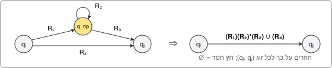
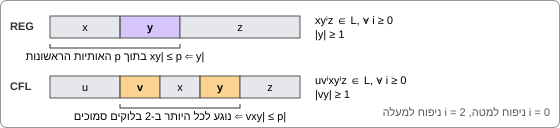
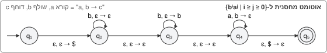
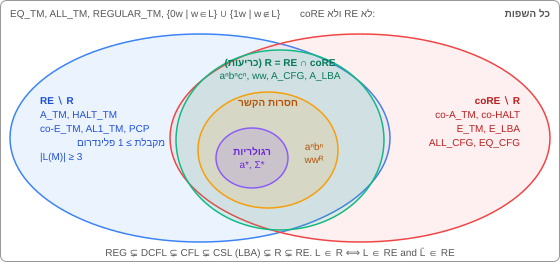
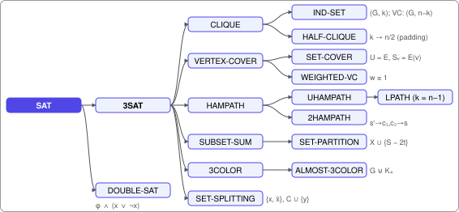

# מודלים חישוביים (20604) — סיכום למבחן

## מילון סימונים

- **‏$`\Sigma`$ (א"ב):** קבוצת האותיות, למשל $`\{a,b\}`$. **מילה** = רצף אותיות. **שפה** = קבוצה של מילים (סופית או אינסופית).
- **‏$`\varepsilon`$:** המילה הריקה (אורך 0). **‏$`\emptyset`$:** השפה הריקה (אין בה אף מילה — שונה מ-$`\{\varepsilon\}`$, שיש בה מילה אחת).
- **‏$`\Sigma^*`$:** כל המילים מעל הא"ב. **‏$`|w|`$:** האורך של $`w`$. **‏$`a^n`$:** האות $`a`$ חוזרת $`n`$ פעמים, למשל $`a^3=aaa`$. **‏$`\#_a(w)`$ או "‏#a":** מספר ה-$`a`$ במילה.
- **פעולות על שפות:** $`L_1\cup L_2`$ איחוד, $`L_1\cap L_2`$ חיתוך, $`\overline L`$ משלים (כל המילים שאינן ב-$`L`$), $`L_1\setminus L_2`$ הפרש, $`L_1L_2`$ שרשור (מילה מ-$`L_1`$ ואחריה מילה מ-$`L_2`$), $`L^*`$ כוכב קלין (שרשור של 0 או יותר מילים מ-$`L`$), $`w^R`$ המילה הפוכה.
- **‏$`\langle M\rangle`$:** קידוד של מכונה (או גרף, נוסחה) כמחרוזת, כדי שאפשר יהיה לתת אותה כקלט למכונה אחרת.
- **‏"סגורה תחת פעולה":** מפעילים את הפעולה על שפות מהמחלקה ותמיד מקבלים שפה מאותה מחלקה.
- **כדי להפריך טענה כללית** ("תמיד…", "בהכרח…") מספיקה **דוגמה נגדית אחת**. רוב השאלות "הוכיחו או הפריכו" במבחנים נפתרות כך.

## חלק 1 — שפות רגולריות

**במילים פשוטות:** שפה רגולרית היא שפה שאפשר לזהות עם **זיכרון סופי וקבוע** — קוראים את המילה אות אחר אות, ובכל רגע זוכרים רק "באיזה מצב אנחנו" מתוך מספר סופי של מצבים. לכן אפשר לבדוק "האם מספר ה-a זוגי" (שני מצבים), אבל אי אפשר לבדוק "האם יש בדיוק אותו מספר של a ושל b" — לשם כך צריך לספור עד אינסוף.

### מכונות וביטויים

- **‏מרכיבי אוטומט:** קבוצת מצבים, א"ב, כללי מעבר, מצב התחלתי וקבוצת מצבים מקבלים (מסומנים בעיגול כפול). קוראים את המילה משמאל לימין; אם בסוף הקריאה נמצאים במצב מקבל, המילה **מתקבלת**.
- **‏אס"ד (DFA, אוטומט סופי דטרמיניסטי):** לכל מצב ולכל אות יש **מעבר אחד בדיוק** (למשל: מ-$`q_0`$ עם $`a`$ עוברים ל-$`q_1`$). אם לאות מסוימת אין לאן ללכת, מוסיפים **מצב מלכודת** — מצב לא מקבל שאי אפשר לצאת ממנו.
- **‏אסל"ד (NFA, לא דטרמיניסטי):** ממצב אחד עם אותה אות אפשר לעבור לכמה מצבים או לאף אחד, ויש גם **מעברי ε** — מעבר בלי לקרוא אות. אפשר לחשוב שהאוטומט "מתפצל" ובודק את כל האפשרויות במקביל; הוא מקבל אם **לפחות ענף אחד** מסתיים במצב מקבל.
- **‏ביטוי רגולרי:** דרך לכתוב שפה רגולרית בנוסחה. אבני הבניין: אות $`a`$, המילה הריקה $`\varepsilon`$, השפה הריקה $`\emptyset`$, ואיתם $`R_1\cup R_2`$ ("או"), $`R_1R_2`$ ("ואחריו"), $`R^*`$ ("0 פעמים או יותר"). למשל $`(a\cup b)^*b`$ = כל המילים שמסתיימות ב-$`b`$. זהויות: $`R\cup\emptyset=R`$, $`R\varepsilon=R`$, $`R\emptyset=\emptyset`$, $`\emptyset^*=\{\varepsilon\}`$.
- **שלושת התיאורים שקולים:** שפה רגולרית = יש לה DFA = יש לה NFA = יש לה ביטוי רגולרי (משפטים 1.39, 1.54, 1.60). לכן מותר לבחור את הצורה הנוחה ביותר.

### המרות

- **‏NFA אל DFA (בניית תת-הקבוצות):** הרעיון — ה-DFA זוכר את **כל המצבים שה-NFA יכול להיות בהם כרגע**, ולכן כל מצב של ה-DFA הוא **קבוצה** של מצבי NFA.
  - **סגור ε** של מצב = המצב עצמו ועוד כל מה שאפשר להגיע אליו בחיצי ε בלבד.
  - מצב ההתחלה = סגור ה-ε של מצב ההתחלה של ה-NFA.
  - מעבר מקבוצה עם אות $`a`$: מכל מצב בקבוצה הולכים עם $`a`$, מאחדים את כל התוצאות, ומוסיפים את סגור ה-ε שלהן.
  - קבוצה היא מצב מקבל אם יש בה לפחות מצב מקבל אחד. בסוף מוחקים מצבים שאי אפשר להגיע אליהם.
  - דוגמה: אם ב-NFA $`A\xrightarrow{a}B`$, $`C\xrightarrow{a}D`$ ו-$`D\xrightarrow{\varepsilon}E`$, אז ב-DFA יש מעבר מהמצב $`\{A,C\}`$ עם $`a`$ אל המצב $`\{B,D,E\}`$.
- **‏DFA אל ביטוי רגולרי (שיטת GNFA):** הרעיון — מרשים לכתוב על חץ **ביטוי רגולרי שלם** במקום אות אחת, ומעלימים מצבים אחד אחד עד שנשארים רק מצב התחלה ומצב סיום עם חץ אחד ביניהם. הביטוי על החץ הזה הוא התשובה.
  1. מוסיפים מצב התחלתי חדש עם חץ ε אל מצב ההתחלה הישן, ומצב מקבל יחיד חדש עם חצי ε מכל המצבים המקבלים הישנים.
  2. כמה חצים בין אותם שני מצבים מאחדים לחץ אחד עם $`\cup`$. חץ שלא קיים נחשב $`\emptyset`$.
  3. מסלקים כל פעם מצב אחד, ולכל זוג מצבים שעברו דרכו מעדכנים את החץ הישיר ביניהם:



  בציור: כדי לעבור מ-$`q_i`$ אל $`q_j`$ היה אפשר לעבור דרך המצב המסולק ($`R_1`$, אחר כך הלולאה $`R_2`$ כמה פעמים שרוצים, אחר כך $`R_3`$), או בחץ הישיר $`R_4`$.
- **‏ביטוי רגולרי אל NFA:** בונים מלמטה למעלה. **איחוד** — מצב התחלתי חדש עם חצי ε אל שני האוטומטים. **שרשור** — חצי ε מהמצבים המקבלים של הראשון אל ההתחלה של השני. **כוכב** — מצב התחלתי חדש שהוא גם מקבל (כדי לקבל את $`\varepsilon`$), וחצי ε מהמצבים המקבלים חזרה להתחלה (כדי לחזור על המילה).
- **‏משלים:** ב-**DFA** הופכים מצבים מקבלים ללא מקבלים ולהפך. ב-NFA זה **לא** עובד — אם ענף אחד דוחה וענף אחר מקבל, המילה עדיין מתקבלת.
- **חיתוך / איחוד (אוטומט מכפלה):** מריצים את שני האוטומטים **במקביל**. כל מצב של האוטומט החדש הוא **זוג**: איפה האוטומט הראשון נמצא ואיפה השני נמצא. בכל אות שני החלקים של הזוג מתקדמים. בחיתוך הזוג מקבל אם **שניהם** במצב מקבל; באיחוד — אם **לפחות אחד**.
- **‏[מבחן 2026ב] השפה $`\{tuv: t\in L_1,v\in L_2\}`$** (מילה שמתחילה במילה מ-$`L_1`$ ומסתיימת במילה מ-$`L_2`$, עם כל דבר באמצע): בונים NFA מהמצבים של שני האוטומטים ועוד מצב חדש $`n`$. מכל מצב מקבל של הראשון חץ ε אל $`n`$; ב-$`n`$ לולאה על כל אות (זה ה-"כל דבר באמצע"); מ-$`n`$ חץ ε אל מצב ההתחלה של השני; המצבים המקבלים הם של השני. את המעברים רושמים פורמלית **לפי מקרים**: מצב של האוטומט הראשון, המצב $`n`$, מצב של השני.

### סגירות

| רגולריות סגורות תחת | לא סגורות תחת |
| --- | --- |
| איחוד, חיתוך, משלים, הפרש, שרשור, כוכב, היפוך, הוספה או הורדה של מספר סופי של מילים | איחוד של **אינסוף** שפות: כל $`\{a^kb^k\}`$ היא שפה סופית ולכן רגולרית, אבל האיחוד של כולן הוא $`\{a^nb^n\}`$, שאינה רגולרית |

- שרשור מתפלג על איחוד: $`(L_1\cup L_2)L_3=L_1L_3\cup L_2L_3`$. על חיתוך **לא**: עם $`L_1=\{a\}`$, $`L_2=\{aa\}`$, $`L_3=\{a,aa\}`$ החיתוך $`L_1\cap L_2`$ ריק, אבל $`L_1L_3\cap L_2L_3=\{aaa\}`$.
- **שימוש בסגירות כדי להוכיח אי-רגולריות:** אם $`L`$ הייתה רגולרית, גם $`L\cap a^*b^*`$ הייתה רגולרית (חיתוך של שתי רגולריות). אם יוצא $`\{a^nb^n\}`$ — סתירה, ולכן $`L`$ לא רגולרית. אפשר לעשות אותו דבר עם משלים.

### מתכונים לבניית DFA

- **ספירה מודולו k:** כדי לבדוק "מספר ה-a מתחלק ב-3" מספיקים 3 מצבים — השארית הנוכחית (0, 1 או 2). כשיש כמה תנאים, לוקחים מצב לכל צירוף של שאריות. **[2026ב]** $`0^i1^j`$ עם $`i`$ שמתחלק ב-3, $`j`$ שנותן שארית 1 בחלוקה ב-3, ואורך זוגי: סופרים את ה-0 מודולו 6 ואחר כך את ה-1 מודולו 6 (מודולו 6 נותן גם את השארית ב-3 וגם את הזוגיות).
- **חיפוש תת-מחרוזת:** כל מצב זוכר "כמה מהתבנית כבר ראינו ברצף" (החלק הארוך ביותר מסוף מה שנקרא עד עכשיו שהוא גם התחלה של התבנית), ומוסיפים מצב מלכודת אם צריך. **[2025א]** "התת-מחרוזת $`111`$ מופיעה בדיוק פעם אחת" (שימו לב: ב-$`1111`$ יש שני מופעים): המצב זוכר כמה מופעים כבר היו (0 או 1) וכמה 1 יש עכשיו ברצף; במופע השני עוברים למלכודת. **[דוגמה]** "$`w\neq ba`$ וגם אין $`bab`$": בונים DFA לכל תנאי בנפרד ולוקחים מכפלה (חיתוך).

### למת הניפוח (רגולריות)

**במילים פשוטות:** לאוטומט יש רק $`p`$ מצבים. מילה ארוכה מ-$`p`$ מכריחה אותו לבקר באותו מצב פעמיים, כלומר יש בתחילת המילה קטע $`y`$ שהוא **לולאה**. אפשר לעבור בלולאה 0 פעמים, פעמיים או 100 פעמים, והאוטומט לא ירגיש — המילה עדיין תתקבל. כדי להוכיח ששפה **לא** רגולרית, מראים מילה שבה "הכפלת הלולאה" מוציאה מהשפה.



הניסוח: לכל שפה רגולרית $`L`$ יש מספר $`p`$ כך שכל מילה $`s\in L`$ באורך לפחות $`p`$ אפשר לחלק לשלושה חלקים $`s=xyz`$ שמקיימים:

```math
|y|>0,\qquad |xy|\le p,\qquad xy^iz\in L\ \text{ for every } i\ge0
```

כלומר $`y`$ לא ריק, הוא נמצא בתוך $`p`$ האותיות הראשונות, ו"ניפוח" שלו ($`y`$ חוזר $`i`$ פעמים) משאיר את המילה בשפה.

**‏תבנית הוכחה (בשלילה):**
1. נניח ש-$`L`$ רגולרית, ויהי $`p`$ קבוע הניפוח שלה.
2. בוחרים מילה מסוימת $`s\in L`$ באורך לפחות $`p`$ (המילה תלויה ב-$`p`$ — ראו טבלה).
3. כיוון ש-$`|xy|\le p`$, החלק $`y`$ נמצא כולו בבלוק הראשון של המילה, למשל $`y=a^k`$ עם $`k\ge1`$. זה צריך לעבוד **לכל** חלוקה אפשרית.
4. בוחרים $`i`$ — בדרך כלל $`i=2`$ ("ניפוח למעלה") או $`i=0`$ ("ניפוח למטה", מוחקים את $`y`$) — ומראים ש-$`xy^iz\notin L`$. זו סתירה, ולכן $`L`$ לא רגולרית.

| שפה | בוחרים $`s`$ | למה הניפוח נכשל |
| --- | --- | --- |
| ‏$`\{a^nb^n\}`$ | ‏$`a^pb^p`$ | ‏$`y`$ כולו a; עם $`i=2`$ יש יותר a מ-b |
| ‏$`\{c^{3n}a^nb^{2n}\}`$ **[דוגמה 1]** | ‏$`c^{3p}a^pb^{2p}`$ | ‏$`y=c^k`$; עם $`i=2`$ מספר ה-c הוא $`3p+k`$, ולא פי 3 ממספר ה-a |
| אורך אי-זוגי, האות האמצעית $`b`$ **[65]** | ‏$`a^pba^p`$ | ‏$`y=a^k`$, ‏$`i=2`$. אם $`k`$ אי-זוגי, האורך נעשה זוגי. אם $`k`$ זוגי, האמצע זז שמאלה ונופל על $`a`$ |
| ‏$`\{0^n: n\text{ prime}\}`$ (אורך ראשוני) | ‏$`0^n`$ עם $`n\ge p`$ ראשוני | עם $`i=n+1`$ האורך הוא $`n+n\lvert y\rvert=n(1+\lvert y\rvert)`$ — מכפלה של שני מספרים גדולים מ-1, ולכן לא ראשוני |
| ‏$`\{www\}`$ כש-$`w`$ מתחילה ב-0 **[94]** | ‏$`01^p01^p01^p`$ | אם $`y`$ מתחיל ב-0 הראשון, ניפוח למטה מוחק אותו (המילה מתחילה ב-1). אחרת $`y`$ הוא רק 1-ים מהבלוק הראשון, וניפוח למטה מקצר רק את השליש הראשון |

- הלמה היא תנאי **הכרחי** ולא מספיק: יש שפות לא רגולריות שמקיימות אותה, למשל $`\{a^ib^jc^k:\ \text{if } i=1 \text{ then } j=k\}`$. לכן משתמשים בה רק כדי להוכיח ששפה **לא** רגולרית.
- **‏[2026ב]** שפה **אונרית** (מעל אות אחת, $`\Sigma=\{a\}`$) שמקיימת את למת הניפוח של חסרות הקשר מקיימת גם את הלמה של רגולריות. בשפה אונרית רק האורך משנה, אז מעבירים את כל מה שמנופח להתחלה: $`x'=\varepsilon`$, $`y'=a^{|vy|}`$ (אורכו בין 1 ל-$`p`$), ו-$`z'`$ = השאר. הניפוח של $`y'`$ נותן בדיוק את אותם אורכים כמו הניפוח של $`v`$ ו-$`y`$ יחד.

### מאגר שאלות מבחן — רגולריות

- **‏[2025א] אם $`AB`$ רגולרית, האם $`A`$ בהכרח רגולרית? לא.** דוגמה נגדית: $`A=\{a^nb^n\mid n\ge0\}`$ (לא רגולרית, ומכילה את $`\varepsilon`$) ו-$`B=\Sigma^*`$. כל מילה $`w`$ היא $`\varepsilon\cdot w`$, ולכן $`AB=\Sigma^*`$ — רגולרית.
- **אם $`L^*`$ רגולרית, האם $`L`$ בהכרח רגולרית? לא.** $`L=\{a,b\}\cup\{a^nb^n\}`$: בגלל $`a`$ ו-$`b`$ אפשר לבנות כל מילה, ולכן $`L^*=\Sigma^*`$.
- **‏[דוגמה 2]** ‏$`L_1`$ רגולרית, $`L_2`$ לא, החיתוך לא רגולרי והאיחוד רגולרי: $`L_1=0^*`$, $`L_2=\{0^n: n\text{ prime}\}`$. החיתוך הוא $`L_2`$ (לא רגולרית), והאיחוד הוא $`0^*`$.
- **‏[דוגמה 2]** ‏$`(L_1\cup L_2)^*=L_1^*\cup L_2^*`$ כששום שפה לא מוכלת בשנייה: $`L_1=\{a\}`$, $`L_2=\{aa\}`$ (בשני הצדדים יוצא $`a^*`$).
- **‏[94] הוכחה שגויה:** "השפה $`M`$ של המילים שמתחילות ב-0 רגולרית, ו-$`L=\{www\}`$ היא $`MMM`$, ולכן רגולרית". זה שגוי, כי $`MMM`$ מכילה גם שרשור של **שלוש מילים שונות**, למשל $`0\cdot01\cdot011`$, ולכן $`MMM\neq\{www\}`$.
- **ביטויים רגולריים מהמבחנים:**
  - אורך אי-זוגי שמסתיים ב-$`b`$: $`((a\cup b)(a\cup b))^*b`$ — זוגות של אותיות, ואחריהם $`b`$.
  - אורך שמתחלק ב-3: $`((0\cup1)(0\cup1)(0\cup1))^*`$.
  - לפחות שני 0, **או** לכל היותר 1 אחד: $`\Sigma^*0\Sigma^*0\Sigma^*\ \cup\ 0^*(\varepsilon\cup1)0^*`$.
  - ‏$`a^nb^m`$ עם $`n,m\ge1`$ ו-$`nm\ge3`$, לפי מקרים ($`n\ge3`$; $`n=1, m\ge3`$; $`n=2, m\ge2`$): $`aaaa^*bb^*\cup abbbb^*\cup aabbb^*`$.
  - ‏NFA בן 3 מצבים ל-$`1^*0^*1^*1`$: מצב 1 עם לולאה על 1, חץ ε למצב 2 עם לולאה על 0, חץ 1 למצב 3 (מקבל) עם לולאה על 1.
- **תשובות של המרת אוטומט לביטוי רגולרי:**
  - **‏[65]** $`b^*(ba^*\cup a)b^*`$ (מצב $`q_4`$ לא מוביל למצב מקבל, ולכן מוחקים אותו מראש).
  - **‏[דוגמה 2]** $`(aa\cup b)a^*ba^*`$.
  - **‏[2025א]** מספר אי-זוגי של 1: אחרי סילוק $`q_1`$, הלולאה על $`q_0`$ היא $`0\cup10^*1`$ והחץ ממנו לסיום הוא $`10^*`$; אחרי סילוק $`q_0`$ התשובה היא $`(0\cup10^*1)^*10^*`$.

## חלק 2 — שפות חסרות הקשר

**במילים פשוטות:** שפה חסרת הקשר היא שפה שאפשר לתאר ב**דקדוק** — כללי החלפה כמו $`S\to aSb`$ — או לזהות עם אוטומט שיש לו **מחסנית** (זיכרון לא מוגבל, אבל אפשר לראות רק את הפריט העליון). המחסנית מאפשרת "לספור ולהשוות" דבר אחד מול דבר אחר: לדחוף a-ים ואז לשלוף אחד על כל b בודק $`a^nb^n`$. אבל היא לא יכולה להשוות שלושה דברים, כמו ב-$`a^nb^nc^n`$.

### דקדוקים וצורה נורמלית

- **דקדוק חסר הקשר:** יש **משתנים** (אותיות גדולות, למשל $`S`$), **טרמינלים** (האותיות של המילה עצמה, שכבר לא מחליפים), **כללים** ($`S\to aSb\mid\varepsilon`$ אומר: אפשר להחליף את $`S`$ ב-$`aSb`$ או במילה הריקה), ומשתנה התחלתי. **גזירה** = מתחילים מ-$`S`$ ומפעילים כללים עד שנשארים רק טרמינלים. למשל $`S\Rightarrow aSb\Rightarrow aaSbb\Rightarrow aabb`$.
- **גזירה שמאלית ביותר:** בכל צעד מחליפים את המשתנה השמאלי ביותר. **דקדוק דו-משמעי:** יש מילה שאפשר לגזור בשתי דרכים שונות באמת (שתי גזירות שמאליות שונות, כלומר שני עצי גזירה). יש שפות שכל דקדוק שלהן דו-משמעי.
- **האם מילה $`w`$ נגזרת בדקדוק?** אם כן — מראים את צעדי הגזירה. אם לא — מוצאים תכונה שנשמרת בכל גזירה (למשל "כל מילה לא ריקה מתחילה ב-a", או יחס קבוע בין מספרי האותיות), ומראים ש-$`w`$ לא מקיימת אותה.
  - **‏[65]** הדקדוק $`S\to AB\mid\varepsilon`$, $`A\to aB`$, $`B\to Sb`$ שקול ל-$`S\to aSbSb\mid\varepsilon`$ (מציבים את $`A`$ ואת $`B`$). את $`aabbbb`$ אפשר לגזור: $`S\Rightarrow aSbSb`$, את ה-$`S`$ הראשון מחליפים ב-$`aSbSb`$ ואת כל השאר ב-$`\varepsilon`$. את $`bbba`$ אי אפשר: כל מילה לא ריקה מתחילה ב-$`a`$.
  - **‏[דוגמה 2]** הדקדוק של ביטויים ($`S\to S+S\mid -S\mid \dots\mid 0\mid\dots\mid9`$) גוזר את $`---5`$ (שלוש פעמים $`S\to -S`$) ואת $`2+--4`$.
- **צורה נורמלית של חומסקי (CNF):** כל כלל הוא "משתנה הופך לשני משתנים" ($`A\to BC`$) או "משתנה הופך לטרמינל אחד" ($`A\to a`$); בנוסף מותר $`S\to\varepsilon`$, והמשתנה ההתחלתי לא מופיע בצד ימין של אף כלל. בצורה הזו מילה באורך $`n`$ נגזרת בדיוק ב-$`2n-1`$ צעדים, ולכן אפשר לבדוק את כל הגזירות. שלבי ההמרה:
  1. מוסיפים משתנה התחלתי חדש $`S_0\to S`$;
  2. מסלקים כללי $`A\to\varepsilon`$: בכל כלל שמופיע בו $`A`$ מוסיפים גרסה **בלי** המופע הזה;
  3. מסלקים כללי יחידה (משתנה שהופך למשתנה אחד, $`A\to B`$): מעתיקים ל-$`A`$ את כל הכללים של $`B`$;
  4. מפרקים כללים ארוכים לשרשרת של כללים עם שני משתנים, בעזרת משתני עזר;
  5. בכללים ארוכים מחליפים כל טרמינל $`a`$ במשתנה חדש $`U_a`$ עם הכלל $`U_a\to a`$.

  **‏[דוגמה 2]** סילוק $`A\to\varepsilon`$ מתוך $`S\to1SA0A\mid0AS1S\mid\varepsilon`$, $`A\to10S1\mid\varepsilon`$: בכל מקום שיש $`A`$ מוסיפים גרסה בלעדיו, ומקבלים $`S\to1SA0A\mid1S0A\mid1SA0\mid1S0\mid0AS1S\mid0S1S\mid\varepsilon`$ ו-$`A\to10S1`$.

### אוטומט מחסנית (PDA)

- **‏אוטומט מחסנית:** כמו NFA, אבל עם מחסנית. בכל מעבר האוטומט יכול לקרוא אות מהקלט (או לא), לשלוף את הסמל העליון במחסנית (או לא), ולדחוף סמל חדש (או לא). התווית $`a,b\to c`$ אומרת: קוראים $`a`$, שולפים $`b`$, דוחפים $`c`$; ‏$`\varepsilon`$ במקום כלשהו = "לא עושים את זה". הוא **לא דטרמיניסטי**, ולכן יכול "לנחש" למשל איפה אמצע המילה. בהתחלה דוחפים סמל מיוחד `$` כדי לדעת מתי המחסנית התרוקנה.



  בציור: האוטומט מדלג על חלק מה-b-ים (אלה ה-b-ים העודפים), דוחף את שאר ה-b-ים, שולף b אחד על כל a, ומקבל אם הגיע ל-`$`. כך מספר ה-a לא עולה על מספר ה-b.
- **דקדוק אל אוטומט מחסנית:** המחסנית מחזיקה את מה שעוד צריך לגזור. דוחפים את `$` ומעליו $`S`$. אם בראש המחסנית יש משתנה, מחליפים אותו באחד הכללים שלו (ניחוש). אם יש טרמינל, משווים אותו לאות הבאה בקלט ומוחקים.
- **אוטומט מחסנית אל דקדוק:** לכל שני מצבים $`p,q`$ יוצרים משתנה $`A_{pq}`$ שגוזר את המילים שמעבירות את האוטומט מ-$`p`$ ל-$`q`$ כשהמחסנית ריקה בהתחלה ובסוף. אם המחסנית מתרוקנת באמצע, מפצלים ל-$`A_{pr}A_{rq}`$; אחרת, האות הראשונה דוחפת והאחרונה שולפת, ולכן $`A_{pq}\to aA_{rs}b`$.
- **‏DFA אל דקדוק:** משתנה לכל מצב; לכל מעבר מ-$`R_i`$ עם $`a`$ אל $`R_j`$ כלל $`R_i\to aR_j`$; לכל מצב מקבל $`R_i\to\varepsilon`$. לכן כל שפה רגולרית היא גם חסרת הקשר.
- **‏[2025א]** $`a^kb^nc^m`$ כאשר $`m`$ הוא $`(k+n)/2`$ מעוגל למטה: דוחפים $`X`$ על כל $`a`$ ועל כל $`b`$, ושולפים שני $`X`$ על כל $`c`$. בסוף מקבלים אם נשאר במחסנית רק `$`, או $`X`$ אחד מעל `$` (כש-$`k+n`$ אי-זוגי).

### ספריית דקדוקים

| שפה | דקדוק | הרעיון |
| --- | --- | --- |
| מספר שווה של 0 ו-1 | ‏$`S\to0S1S\mid1S0S\mid\varepsilon`$ | כל 0 "מתאים" ל-1 כלשהו |
| מספר ה-0 כפול ממספר ה-1 **[2025א]** | ‏$`S\to S0S0S1S\mid S0S1S0S\mid S1S0S0S\mid\varepsilon`$ | כל 1 עם שני 0, בכל סדר |
| ‏$`a^nb^m`$ עם $`n>m`$ | ‏$`S\to aSb\mid A,\ A\to aA\mid a`$ | זוגות $`a\dots b`$, ועוד לפחות $`a`$ אחד |
| ‏$`a^nb^m`$ עם $`n\neq m`$ | ‏$`S\to aSb\mid A\mid B,\ A\to aA\mid a,\ B\to bB\mid b`$ | זוגות, ועוד עודף של a **או** של b |
| המשלים של $`\{a^nb^n\}`$ **[דוגמה 1]** | ‏$`S\to S_1\mid S_2\mid S_3`$; $`S_1\to aS_1b\mid aS_1\mid a`$; $`S_2\to aS_2b\mid S_2b\mid b`$; $`S_3\to XbXaX`$, $`X\to aX\mid bX\mid\varepsilon`$ | יותר a, או יותר b, או ש-b מופיע לפני a |
| המשלים של $`\{ww\}`$ | ‏$`S\to A\mid B\mid AB\mid BA`$; $`A\to CAC\mid0`$; $`B\to CBC\mid1`$; $`C\to0\mid1`$ | אורך אי-זוגי, או שני חצאים ששונים במקום כלשהו |
| ‏$`ww^R`$ (פלינדרום זוגי) | ‏$`S\to aSa\mid bSb\mid\varepsilon`$ | אותה אות בשני הקצוות |
| אורך אי-זוגי עם $`b`$ באמצע | ‏$`S\to aSa\mid aSb\mid bSa\mid bSb\mid b`$ | אות כלשהי בכל צד, $`b`$ במרכז |
| ‏$`A\cup B`$, ‏$`AB`$, ‏$`A^*`$ **[דוגמה 2]** | ‏$`S\to S_1\mid S_2`$; ‏$`S\to S_1S_2`$; ‏$`S'\to S'S\mid\varepsilon`$ | קודם משנים שמות כדי שלשני הדקדוקים לא יהיו משתנים משותפים |

**‏[2026ב]** דקדוק למילים מהצורה $`x+yz`$, כאשר $`x,y`$ מספרים בינאריים באותו אורך, ו-$`z`$ הוא $`E`$ אם $`x+y`$ זוגי או $`O`$ אם אי-זוגי. הזוגיות נקבעת רק לפי הספרה האחרונה של כל מספר. הרעיון: הדקדוק בונה את $`x`$ ואת $`y`$ מבחוץ פנימה, ספרה של $`x`$ יחד עם ספרה של $`y`$, כדי שהאורכים יהיו שווים. המשתנים "זוכרים" את הספרות האחרונות, ובסוף נגזרת האות $`E`$ או $`O`$ המתאימה.

### למת הניפוח (חסרות הקשר)

**במילים פשוטות:** במילה ארוכה מספיק, עץ הגזירה חייב להשתמש באותו משתנה פעמיים לאורך מסלול אחד. את החלק שבין שני המופעים אפשר לחזור עליו, ולכן יש **שני קטעים** $`v`$ ו-$`y`$ שמתנפחים **יחד**.

```math
s=uvxyz,\qquad |vy|>0,\qquad |vxy|\le p,\qquad uv^ixy^iz\in L\ \text{ for every } i\ge0
```

**‏תבנית:** כיוון ש-$`|vxy|\le p`$, הקטע $`vxy`$ קצר ולכן נוגע לכל היותר ב-**שני בלוקים סמוכים** (למשל ב-a וב-b, אבל לא גם ב-c). בודקים את המקרים:
- אם $`v`$ או $`y`$ מכילים שתי אותיות שונות, ניפוח למעלה שובר את הסדר (למשל נוצר $`\dots ab\,ab\dots`$).
- אחרת יש בלוק אחד ש-$`v`$ ו-$`y`$ לא נוגעים בו. מנפחים למעלה או למטה כדי לשבור את היחס בין הבלוק הזה לשאר.

| שפה | בוחרים $`s`$ | למה הניפוח נכשל |
| --- | --- | --- |
| ‏$`\{a^nb^nc^n\}`$, וגם $`\{a^kb^nc^m: n\le k\le m\}`$ **[2025א]** | ‏$`a^pb^pc^p`$ | ‏$`vxy`$ לא נוגע גם ב-a וגם ב-c, ולכן הניפוח משנה רק חלק מהבלוקים |
| ‏$`\{a^ib^jc^k: k>j>i\}`$ **[דוגמה]** | ‏$`a^pb^{p+1}c^{p+2}`$ | כל בלוק גדול מהקודם באחד בדיוק, ולכן כל שינוי בבלוק אחד שובר אי-שוויון |
| ‏$`\{ww\}`$ | ‏$`0^p1^p0^p1^p`$ | ‏$`vxy`$ חייב לחצות את האמצע; ניפוח למטה מקלקל את השוויון בין החצאים |
| ‏$`\{ww^Rw\}`$ | ‏$`0^p1^p\,1^p0^p\,0^p1^p`$ | אותו רעיון: הניפוח פוגע רק בשליש אחד או בשניים |
| ‏$`\{0^j1^k: k>j^2\}`$ **[94]** | ‏$`0^p1^{p^2+1}`$ | אם מנופחים רק 1-ים, ניפוח למטה מקטין את מספר ה-1 אל $`p^2`$ או פחות. אם מנופחים גם 0-ים, ניפוח למעלה מגדיל את $`j^2`$ ביותר מ-$`p`$, בעוד שמספר ה-1 גדל בפחות מ-$`p`$ |
| ‏$`\{a^ib^jc^{\max(i,j)}\}`$ | ‏$`a^pb^pc^p`$ | אם מנופחים a או b, ניפוח למעלה מגדיל את המקסימום אבל לא את ה-c. אם מנופח c, ניפוח למטה מקטין את ה-c מתחת למקסימום |

### סגירות (חסרות הקשר)

| סגורות | לא סגורות |
| --- | --- |
| איחוד, שרשור, כוכב, היפוך, **חיתוך עם שפה רגולרית** (מריצים את אוטומט המחסנית ואת ה-DFA במקביל) | **חיתוך:** $`a^nb^nc^*\cap a^*b^nc^n=a^nb^nc^n`$. **משלים**. **הפרש** (כי $`\Sigma^*\setminus B`$ הוא המשלים של $`B`$) |

- למה חיתוך של שתי חסרות הקשר לא עובד: לכל אחת יש מחסנית משלה, ואי אפשר לדמות שתי מחסניות עם מחסנית אחת.
- ‏DCFL (שפות של אוטומט מחסנית **דטרמיניסטי**) כן סגורה תחת משלים, וזו תת-מחלקה ממש של חסרות הקשר.
- **‏[דוגמה/94] ההפרש של שתי חסרות הקשר לא בהכרח חסר הקשר:** $`A=a^nb^nc^*`$, ו-$`B`$ = המילים $`a^*b^nc^m`$ עם $`n\neq m`$. אז $`A\setminus B=a^nb^nc^n`$.
- **‏[65]** כש-$`A,B,C`$ חסרות הקשר, $`\overline{A}(B\cup C)`$ לא בהכרח חסרת הקשר: עם $`B=\{\varepsilon\}`$, $`C=\emptyset`$ מקבלים $`\overline A`$, ואם $`A`$ היא המשלים של $`a^nb^nc^n`$ (שהוא חסר הקשר), אז $`\overline A=a^nb^nc^n`$. לעומת זאת $`A(B\cup C)`$ תמיד חסרת הקשר (איחוד ושרשור).
- **‏[דוגמה 1]** שתי שפות שאינן חסרות הקשר יכולות להיחתך לשפה חסרת הקשר: $`\{a^nb^nc^n\}\cap\{b^na^nc^n\}=\{\varepsilon\}`$.
- **‏[דוגמה 1]** שפה חסרת הקשר פחות אינסוף מילים לא בהכרח רגולרית: $`\Sigma^*`$ פחות $`\{a^nb^n\}`$ נותן את המשלים של $`a^nb^n`$, שאינו רגולרי.

### ההיררכיה

**‏[דוגמה/94]** שאלה שחוזרת: רושמים בכל אליפסה את שם המחלקה ונותנים דוגמה לשפה שנמצאת בה **אבל לא** באליפסה הפנימית.



סוגי דקדוקים לפי כוח: רגולרי (כללים כמו $`A\to aB`$ או $`A\to\varepsilon`$) ⊂ חסר הקשר ⊂ תלוי הקשר (מחליפים משתנה רק כשהוא מוקף בהקשר מסוים; מתאים ל-LBA, ראו חלק 3) ⊂ כללי (כל מחרוזת יכולה להיות מוחלפת בכל מחרוזת; מתאים למכונת טיורינג).

## חלק 3 — מכונות טיורינג וכריעות

**במילים פשוטות:** מכונת טיורינג היא המודל של "מחשב" — יש לה סרט אינסופי שאפשר לקרוא ולכתוב עליו ולזוז בו לשני הכיוונים. כל אלגוריתם אפשר לממש כמכונת טיורינג. השאלה המרכזית בחלק הזה: **לאילו בעיות יש אלגוריתם שתמיד עוצר עם תשובה?** יש בעיות שאין להן — המפורסמת היא "האם מכונה נתונה מקבלת קלט נתון".

### מכונות טיורינג

- **‏מכונת טיורינג:** בכל צעד המכונה רואה את המצב שלה ואת הסמל שמתחת לראש, ולפי זה כותבת סמל, זזה ימינה או שמאלה ועוברת למצב חדש. בציור $`a\to b,R`$ = קוראים $`a`$, כותבים $`b`$, זזים ימינה. יש מצב מקבל ומצב דוחה; המכונה עוצרת כשהיא מגיעה לאחד מהם. **היא יכולה גם לא לעצור לעולם** (לולאה אינסופית).
- **קונפיגורציה** = תמונת מצב של רגע אחד: תוכן הסרט, ובתוכו שם המצב הנוכחי במקום שבו נמצא הראש. למשל $`xq_1y`$ = הסרט הוא $`xy`$, המכונה במצב $`q_1`$, והראש על $`y`$. ההתחלה היא $`q_0w`$.
- **‏[65]** מכונה שמחליפה 0 ב-$`x`$, רצה ימינה עד ה-1 הראשון ומחליפה אותו ב-$`y`$, וחוזרת — מזהה את $`0^n1^n`$ (כל 0 "מתאים" ל-1 אחד). על הקלט 01 הקונפיגורציות הן: $`q_001`$, $`xq_11`$, $`q_2xy`$, $`xq_0y`$, $`xyq_3\sqcup`$, $`xy\sqcup q_{acc}`$ (‏$`\sqcup`$ = תא ריק).
- **שפה מזוהה (RE, ניתנת לזיהוי):** יש מכונה שעל כל מילה **בשפה** עוצרת ומקבלת. על מילה שאינה בשפה היא דוחה **או רצה לנצח**.
- **שפה כריעה (R, ניתנת להכרעה):** יש מכונה שעוצרת **תמיד** — מקבלת מילים בשפה ודוחה את כל השאר. כלומר יש אלגוריתם.
  - שפה כריעה אם ורק אם גם היא וגם המשלים שלה מזוהות (מריצים את שתי המכונות במקביל; אחת מהן בטוח תעצור).
  - ‏$`A_{TM}`$ = "מכונה $`M`$ וקלט $`w`$ — האם $`M`$ מקבלת את $`w`$?" היא מזוהה (פשוט מריצים) אבל **לא כריעה** (הוכחה בשיטת האלכסון). לכן המשלים שלה, $`\overline{A_{TM}}`$, אפילו לא מזוהה.
- **מודלים ששקולים למכונה רגילה** (מזהים בדיוק את אותן שפות): מכונה עם כמה סרטים (איטית לכל היותר בריבוע), מכונה לא דטרמיניסטית (איטית לכל היותר באקספוננט), מונה (מכונה שמדפיסה את מילות השפה), סרט אינסופי לשני הכיוונים, אוטומט עם שתי מחסניות, מודל RAM.
- **‏LBA (אוטומט חסום לינארית):** מכונת טיורינג שמשתמשת רק בחלק של הסרט שעליו כתוב הקלט. כיוון שהסרט מוגבל, יש לה מספר **סופי** של קונפיגורציות ($`q\cdot n\cdot g^n`$, כאשר $`q`$ מספר המצבים, $`n`$ אורך הקלט, $`g`$ מספר הסמלים). אם היא רצה יותר צעדים מזה, היא חזרה על קונפיגורציה ונמצאת בלולאה. לכן השאלה "האם LBA מקבל את $`w`$" ($`A_{LBA}`$) כריעה.

### מעמד הבעיות המוכרות

| בעיה | מעמד | למה |
| --- | --- | --- |
| האם אוטומט או ביטוי רגולרי מקבל מילה ($`A_{DFA},A_{NFA},A_{REX}`$) | כריעה | ממירים ל-DFA ומריצים — DFA תמיד עוצר |
| האם השפה של DFA ריקה ($`E_{DFA}`$) | כריעה | בודקים אם אפשר להגיע ממצב ההתחלה למצב מקבל |
| האם לשני DFA אותה שפה ($`EQ_{DFA}`$) | כריעה | בונים DFA למילים שנמצאות באחת בלבד, ובודקים אם הוא ריק |
| האם דקדוק גוזר מילה ($`A_{CFG}`$) | כריעה | ממירים לחומסקי ובודקים את כל הגזירות בנות $`2n-1`$ צעדים |
| האם דקדוק לא גוזר כלום ($`E_{CFG}`$) | כריעה | מסמנים משתנים שגוזרים מילה, עד שאין שינוי; בודקים את $`S`$ |
| ‏$`A_{TM}`$, ‏$`HALT_{TM}`$ (האם עוצרת), "השפה של $`M`$ לא ריקה" | מזוהה, לא כריעה | אפשר להריץ ולחכות, אבל ייתכן שנחכה לנצח |
| ‏$`E_{TM}`$ (השפה של $`M`$ ריקה), $`E_{LBA}`$, ‏$`ALL_{CFG}`$ (דקדוק גוזר הכול), ‏$`EQ_{CFG}`$ | המשלים מזוהה, לא כריעה | רדוקציות מ-$`A_{TM}`$ |
| ‏$`EQ_{TM}`$ (לשתי מכונות אותה שפה), $`REGULAR_{TM}`$ | לא היא ולא המשלים מזוהים | רדוקציה מ-$`A_{TM}`$ אליה ואל המשלים שלה |
| ‏PCP (בעיית הדומינו) | מזוהה, לא כריעה | משפט 5.15 |

- **משפט רייס — קיצור דרך:** כל שאלה **לא טריוויאלית על השפה** שמכונה מקבלת היא לא כריעה. "לא טריוויאלית" = יש מכונה שעונה כן ויש מכונה שעונה לא. "על השפה" = שתי מכונות שמקבלות את אותה שפה תמיד מקבלות את אותה תשובה. דוגמאות: "האם השפה אינסופית", "האם מקבלת לפחות פלינדרום אחד".
- שאלות על **התנהגות המכונה עצמה** (כמה צעדים היא עושה, באילו מצבים היא מבקרת, מה היא כותבת) אינן על השפה, ולכן רייס לא חל עליהן — ולעיתים קרובות הן כריעות (ראו "מספר צעדים חסום" בהמשך).

### סגירות

| | איחוד | חיתוך | משלים | שרשור | כוכב |
| --- | --- | --- | --- | --- | --- |
| כריעות | כן | כן | כן | כן | כן |
| מזוהות | כן | כן | **לא** | כן | כן |
| משלים מזוהה | כן | כן | **לא** | | |
| לא כריעות | לא ($`A\cup\overline A=\Sigma^*`$) | לא ($`A\cap\overline A=\emptyset`$) | כן | לא | |

- **‏[65] אם $`L_1\subseteq L\subseteq L_2`$ ו-$`L_1,L_2`$ כריעות, האם $`L`$ כריעה? לא:** $`\emptyset\subseteq A_{TM}\subseteq\Sigma^*`$. באופן כללי, שפה שמוכלת בשפה כריעה לא חייבת להיות כריעה.
- **‏[2025א] אם $`L`$ מזוהה, האם גם $`L^*`$ מזוהה? כן:** לכל $`i=1,2,\dots`$ עוברים על כל הדרכים לחתוך את $`w`$ לחלקים, ומריצים את המכונה של $`L`$ במשך $`i`$ צעדים על כל חלק. מקבלים אם יש חיתוך שבו כל החלקים התקבלו. (ההגבלה ל-$`i`$ צעדים מונעת היתקעות בחלק שעליו המכונה לא עוצרת.)

### טכניקות הוכחה שמקבלות נקודות

> **‏שזירה (dovetailing) — כדי להוכיח ששפה מזוהה.** הבעיה: אם בודקים קלטים אחד אחרי השני, והמכונה לא עוצרת על הראשון, לא נגיע לעולם לשני. הפתרון: בסיבוב $`i`$ מריצים את $`M`$ במשך $`i`$ צעדים בלבד על כל אחד מ-$`i`$ הקלטים הראשונים. כך כל קלט מקבל בסוף כמה צעדים שהוא צריך. **[94, הבודק]** הוריד נקודות על תשובה שהריצה קלטים בזה אחר זה: "ואם M לא עוצרת על הפלינדרום הראשון?"

> **‏מספר צעדים חסום גורר כריעות.** כשהשאלה עוסקת במספר צעדים מוגבל, אפשר להריץ סימולציה מוגבלת שתמיד עוצרת. חובה לנמק למה המכריעה תמיד עוצרת.
> - **‏[דוגמה 1]** "$`M`$ עוצרת על קלט כלשהו תוך פחות מ-$`|\langle M\rangle|`$ צעדים": בפחות מ-$`|\langle M\rangle|`$ צעדים המכונה לא מספיקה לקרוא יותר מזה, ולכן מספיק לבדוק קלטים קצרים מ-$`|\langle M\rangle|`$ — מספר סופי.
> - **‏[דוגמה 2]** "$`M`$ עושה לפחות 5 צעדים על קלט כלשהו": ב-5 צעדים קוראים לכל היותר 5 אותיות, ולכן בודקים רק קלטים באורך עד 5, וכל אחד מריצים 5 צעדים.
> - **‏[דוגמה/94]** "כשמתחילים עם סרט ריק, $`M`$ כותבת מתישהו סמל שאינו רווח": כל עוד הסרט ריק, מה שהמכונה עושה תלוי רק במצב שלה. לכן מריצים $`|Q|`$ צעדים (מספר המצבים). אם עד אז לא נכתב כלום, המכונה כבר חזרה למצב שהייתה בו, ומעכשיו היא תחזור על עצמה לנצח.

- **‏[דוגמה 1]** "השפה של $`M`$ מכילה לפחות 3 מילים" — מזוהה: שוזרים את כל הקלטים ומקבלים אחרי שנמצאו 3 מילים שונות שהתקבלו.
- **‏[דוגמה 1]** "השפה של $`M`$ בת מנייה" — כל שפה היא בת מנייה, כלומר אלה כל המכונות, ולכן השפה כריעה.
- **‏[דוגמה/94]** "$`M`$ מקבלת לפחות פלינדרום אחד" — מזוהה (שוזרים על כל הפלינדרומים) ולא כריעה (רייס).
- **‏[2025א]** השלשות $`\langle a,b,c\rangle`$ של ביטויים רגולריים שבהן $`L(aa\cup bb)=L(cc)`$ — **כריעה**: בונים את שני הביטויים, ממירים כל אחד ל-DFA, ובודקים שוויון (כריע, ראו בטבלה).
- **‏[2026ב]** מכונה לא דטרמיניסטית $`N`$ "מקבלת באופן רב-משמעי" את $`w`$ אם יש ענף שמקבל **וגם** ענף שלא מקבל. צריך לבנות $`N`$ כך שקבוצת המילים האלה לא תהיה מזוהה. לוקחים שפה $`L`$ מזוהה ולא כריעה עם מכונה $`M`$. ‏$`N`$ מתפצלת לשני ענפים: ענף 1 מקבל מיד; ענף 2 מריץ את $`M`$ על $`w`$. אם $`w\in L`$, שני הענפים מקבלים (לא רב-משמעי). אם $`w\notin L`$, ענף 2 לא מקבל (רב-משמעי). לכן הקבוצה היא $`\overline L`$, שאינה מזוהה.
- **‏[דוגמה 2]** ‏$`L'=\{0w: w\in L\}\cup\{1w: w\notin L\}`$, עבור $`L`$ מזוהה ולא כריעה: **לא** $`L'`$ ו**לא** המשלים שלה מזוהים. המילים שמתחילות ב-1 "מכילות" את $`\overline L`$, והמילים שמתחילות ב-0 במשלים מכילות אותה גם כן.

### רדוקציות מיפוי

**במילים פשוטות:** רדוקציה מ-$`A`$ ל-$`B`$ ($`A\le_m B`$) היא **מתרגם**: אלגוריתם שהופך כל קלט של בעיה $`A`$ לקלט של בעיה $`B`$, כך שהתשובה נשמרת ("כן" הופך ל"כן", "לא" הופך ל"לא"). המשמעות: $`B`$ קשה לפחות כמו $`A`$. אם הייתה דרך לפתור את $`B`$, היינו פותרים גם את $`A`$ — מתרגמים ופותרים.

- **איך משתמשים:** אם $`B`$ כריעה, גם $`A`$ כריעה. **ולהפך — וזה השימוש העיקרי:** אם ידוע ש-$`A`$ לא כריעה (למשל $`A_{TM}`$), אז גם $`B`$ לא כריעה. אותו דבר עבור "מזוהה".
- רדוקציה מ-$`A`$ ל-$`B`$ היא גם רדוקציה מהמשלים של $`A`$ למשלים של $`B`$ (אותו מתרגם). לכן כדי להראות ש-$`B`$ **לא מזוהה**, נותנים רדוקציה מ-$`A_{TM}`$ אל **המשלים** של $`B`$.
- הכיוון חשוב: יש רדוקציה מ-$`\{0\}`$ ל-$`HALT`$, אבל לא להפך.
- **‏[דוגמה]** אין רדוקציה מ-$`A_{TM}`$ ל-$`E_{TM}`$: היא הייתה נותנת גם רדוקציה מ-$`\overline{A_{TM}}`$ ל-$`\overline{E_{TM}}`$, שהיא מזוהה, ואז $`\overline{A_{TM}}`$ הייתה מזוהה — סתירה.
- כל שפה כריעה ניתנת לרדוקציה לכל שפה שאינה ריקה ואינה כל המילים: המתרגם פשוט פותר את הבעיה בעצמו, ומחזיר מילה קבועה שבשפה או מילה קבועה שמחוצה לה.
- **‏[תרגיל]** אם $`A`$ מזוהה ויש רדוקציה מ-$`A`$ למשלים שלה, אז $`A`$ כריעה (כי אז גם המשלים מזוהה).
- רדוקציה לשפה רגולרית **לא** אומרת שהשפה המקורית רגולרית (הרדוקציה יכולה לעשות עבודה מסובכת).

> **‏כך כותבים רדוקציה בפורמט של הקורס** (ב-2026ב ירדו 8 מתוך 13 נקודות על רדוקציה שלא נכתבה כך):
> - **הפונקציה:** "על קלט $`\langle M,w\rangle`$: **1.** בנה מכונה $`M'`$ שעל קלט $`x`$: (1) … (2) מריצה את $`M`$ על $`w`$; (3) אם $`M`$ קיבלה — מקבלת. **2.** החזר $`\langle M'\rangle`$."
> - **כיוון ראשון:** אם $`M`$ מקבלת את $`w`$, אז השפה של $`M'`$ היא … ולכן $`\langle M'\rangle`$ ב-$`B`$.
> - **כיוון שני:** אם $`M`$ לא מקבלת את $`w`$, אז השפה של $`M'`$ היא … ולכן $`\langle M'\rangle`$ לא ב-$`B`$.
> - **ניתנת לחישוב:** הפונקציה רק **כותבת תיאור** של $`M'`$; היא אף פעם לא מריצה את $`M`$, ולכן תמיד עוצרת.

| רדוקציה | המכונה $`M'`$ שבונים מ-$`\langle M,w\rangle`$ | למה זה עובד |
| --- | --- | --- |
| ‏$`A_{TM}`$ אל המשלים של $`E_{TM}`$ | על $`x\neq w`$ דוחה; על $`w`$ מריצה את $`M`$ | השפה של $`M'`$ היא $`\{w\}`$ אם $`M`$ מקבלת את $`w`$, וריקה אחרת |
| ‏$`A_{TM}`$ אל $`REGULAR_{TM}`$ | מקבלת מילים מהצורה $`0^n1^n`$; על שאר המילים מריצה את $`M`$ על $`w`$ | השפה היא $`\Sigma^*`$ (רגולרית) אם $`M`$ מקבלת את $`w`$, ו-$`0^n1^n`$ (לא רגולרית) אחרת |
| ‏$`E_{TM}`$ אל $`EQ_{TM}`$ **[2025א]** | זוג: $`M`$ ומכונה שדוחה הכול | השפות שוות בדיוק כשהשפה של $`M`$ ריקה |
| ‏$`A_{TM}`$ אל המשלים של $`EQ_{TM}`$ | ‏$`M_1`$ דוחה הכול; $`M_2`$ מריצה את $`M`$ על $`w`$ ומקבלת | אם $`M`$ מקבלת את $`w`$, ל-$`M_2`$ יש שפה לא ריקה והשתיים שונות |
| ‏$`E_{TM}`$ אל "מצב מיותר" ($`USELESS_{TM}`$) **[דוגמה]** | הזוג $`M`$ ומצב הקבלה שלה | מצב הקבלה אף פעם לא מושג בדיוק כשהשפה ריקה |
| ‏$`HALT`$ אל "עוצרת על הקלט הריק" | ‏$`M'`$ מתעלמת מהקלט שלה ומריצה את $`M`$ על $`w`$ | ‏$`M'`$ עוצרת על הקלט הריק בדיוק כש-$`M`$ עוצרת על $`w`$ |
| ‏$`AL1_{TM}`$ אל $`AL2_{TM}`$ (מקבלת לפחות מילה אחת / שתיים) **[2026ב]** | ‏$`M'`$ על $`x`$: שוזרת את $`M`$ על כל המחרוזות, ואם משהו התקבל — מקבלת את $`x`$ | השפה של $`M'`$ היא כל המילים (יותר משתיים) אם $`M`$ מקבלת משהו, וריקה אחרת |
| ‏$`A_{TM}`$ אל "השפה סגורה תחת היפוך" | מקבלת תמיד את $`01`$; את כל השאר מקבלת אם $`M`$ מקבלת את $`w`$ | השפה היא $`\Sigma^*`$ (סגורה תחת היפוך) או $`\{01\}`$ (לא סגורה, כי $`10`$ חסר) |
| ‏$`A_{TM}`$ אל המשלים של $`E_{LBA}`$ ושל $`ALL_{CFG}`$ | ה-LBA (או אוטומט המחסנית) בודק אם הקלט שלו הוא **היסטוריית חישוב מקבלת** של $`M`$ על $`w`$ — רשימת הקונפיגורציות של ריצה שמסתיימת בקבלה | ריצה כזו קיימת בדיוק כש-$`M`$ מקבלת את $`w`$ |

## חלק 4 — סיבוכיות

**במילים פשוטות:** בחלק הזה השאלה היא כבר לא "האם יש אלגוריתם" אלא "**כמה מהר**". ‏**P** = בעיות שאפשר **לפתור** מהר (בזמן פולינומיאלי, כמו $`n^2`$ או $`n^3`$). ‏**NP** = בעיות שאם מישהו נותן לנו פתרון, אפשר **לבדוק** אותו מהר. למשל, קשה למצוא מסלול שעובר בכל צומת פעם אחת, אבל קל לבדוק מסלול נתון. לא ידוע אם P = NP.

### מחלקות

- **‏P:** בעיות שיש להן אלגוריתם שרץ בזמן $`n^k`$ לאיזשהו $`k`$ קבוע ($`n`$ = אורך הקלט).
- **‏NP:** בעיות שיש להן **מוודא** מהיר: בהינתן קלט ו**אישור** (הצעה לפתרון, באורך פולינומיאלי), אפשר לבדוק בזמן פולינומיאלי שהאישור נכון. באופן שקול: מכונה לא דטרמיניסטית שמנחשת את הפתרון ופותרת בזמן פולינומיאלי (משפט 7.20).
- ‏P מוכלת ב-NP (אם אפשר לפתור, אפשר גם לבדוק), ו-NP מוכלת ב-EXPTIME (זמן אקספוננציאלי — אפשר לנסות את כל האישורים). ‏**coNP** = הבעיות שהמשלים שלהן ב-NP. השאלות "P = NP?" ו-"NP = coNP?" פתוחות; מניחים ששתיהן לא.
- **סגירות:** ‏P סגורה תחת איחוד, חיתוך, משלים, שרשור (בודקים את כל $`n+1`$ הדרכים לחתוך את המילה) וכוכב (תכנון דינמי). ‏NP סגורה תחת איחוד, חיתוך, שרשור וכוכב; לגבי משלים לא ידוע. (להפוך את התשובות של מכונה לא דטרמיניסטית **לא** נותן את המשלים — אותה בעיה כמו ב-NFA.)
- **הקידוד משנה:** הזמן נמדד ביחס לאורך הקלט. מספר $`N`$ בכתיב בינארי תופס רק בערך $`\log N`$ ספרות, ולכן לנסות לחלק את $`N`$ בכל המספרים עד $`N`$ לוקח זמן **אקספוננציאלי** באורך הקלט.

| בעיות ב-P | איך |
| --- | --- |
| ‏PATH (יש מסלול), **SPATH** (יש מסלול פשוט באורך לכל היותר $`k`$) **[65]** | ‏BFS (חיפוש לרוחב) שמסמן את המרחק לכל צומת; מקבלים אם המרחק ליעד הוא לכל היותר $`k`$ |
| ‏RELPRIME (שני מספרים זרים) | אלגוריתם אוקלידס |
| כל שפה חסרת הקשר (משפט 7.16) | תכנון דינמי (אלגוריתם CYK) |
| ‏TRIANGLE (יש בגרף משולש) **[דוגמה 1]** | בודקים את כל שלשות הצמתים — בערך $`n^3`$ שלשות |
| ‏2SAT, 2COLOR (צביעה ב-2 צבעים) | ‏— |
| מסלול / מעגל אוילר (עובר בכל **קשת** פעם אחת) | מסלול: יש 0 או 2 צמתים בדרגה אי-זוגית. מעגל: כל הדרגות זוגיות (והגרף קשיר) |

### ‏NP-שלמות

- **רדוקציה פולינומיאלית ($`A\le_P B`$):** כמו רדוקציית מיפוי, אבל המתרגם חייב לרוץ בזמן פולינומיאלי. אפשר לשרשר רדוקציות.
- **‏NP-שלמה** = הבעיות **הקשות ביותר** ב-NP: הבעיה ב-NP, וכל בעיה ב-NP ניתנת לרדוקציה פולינומיאלית אליה. לכן אם בעיה NP-שלמה אחת נפתרת בזמן פולינומיאלי, כל NP נפתרת, ו-P = NP.
- **‏[דוגמה/94]** "אם VERTEX-COVER ב-P, אז גם HAMPATH ב-P" — **נכון**: VERTEX-COVER היא NP-שלמה, ולכן P = NP, ו-HAMPATH ב-NP.
- **קוק–לוין:** ‏SAT (האם לנוסחה בוליאנית יש השמה שמספקת אותה) היא NP-שלמה, וגם 3SAT (נוסחה שבה כל פסוקית היא "או" של 3 ליטרלים; ליטרל = משתנה או השלילה שלו). מהן מתחילות כמעט כל ההוכחות.

> **‏תבנית להוכחת NP-שלמות (4 חלקים).**
> ‏1. **הבעיה ב-NP:** מה האישור (למשל: הקבוצה עצמה, המסלול, הצביעה), ולמה אפשר לבדוק אותו בזמן פולינומיאלי.
> ‏2. **רדוקציה:** בוחרים בעיה **ידועה** כ-NP-שלמה, ומתארים בצעדים ממוספרים איך הופכים קלט שלה לקלט של הבעיה החדשה. **הכיוון:** מהבעיה הידועה אל החדשה.
> ‏3. **נכונות בשני הכיוונים:** אם התשובה לקלט המקורי היא כן, גם לקלט החדש; **וגם** אם התשובה לקלט החדש היא כן, גם לקלט המקורי.
> ‏4. **זמן:** הבנייה רצה בזמן פולינומיאלי.



בטבלה: **גאדג'ט** = תת-מבנה קטן בגרף (או במספרים) שמחקה חלק אחד של הבעיה המקורית, למשל משתנה אחד או פסוקית אחת.

| רדוקציה | הבנייה | למה זה עובד |
| --- | --- | --- |
| ‏3SAT אל CLIQUE (קליקה = קבוצת צמתים שכולם מחוברים לכולם) ‏(7.32) | צומת לכל ליטרל בכל פסוקית. מחברים כל שני צמתים, חוץ משניים מאותה פסוקית ומ-$`x`$ ו-$`\bar x`$. ‏$`k`$ = מספר הפסוקיות | קליקה בגודל $`k`$ = בחירה של ליטרל אמיתי אחד מכל פסוקית, בלי סתירות |
| ‏CLIQUE, IS, VC (שקולות) | קליקה בגרף = קבוצה בלתי תלויה (אין קשתות בתוכה) **בגרף המשלים** (מחליפים קשתות ואי-קשתות). קבוצה בלתי תלויה בגודל $`k`$ = כיסוי בצמתים (נוגע בכל קשת) בגודל $`n-k`$ — הצמתים שנשארו | שלושתן אותה בעיה בניסוח שונה |
| ‏3SAT אל VC ‏(7.44) | לכל משתנה קשת $`x`$—$`\bar x`$; לכל פסוקית משולש; מחברים כל צומת במשולש לליטרל שלו. ‏$`k`$ = מספר המשתנים + פעמיים מספר הפסוקיות | מכל קשת-משתנה בוחרים את הצד האמיתי, ומכל משולש שני צמתים |
| ‏3SAT אל HAMPATH (מסלול שעובר בכל **צומת** פעם אחת) ‏(7.47) | לכל משתנה "יהלום" — שורת צמתים שעוברים בה משמאל לימין (אמת) או מימין לשמאל (שקר). צומת לכל פסוקית, שאפשר "לקפוץ" אליו מהשורה של ליטרל אמיתי | המסלול קובע ערך לכל משתנה, ועובר בכל פסוקית רק אם יש בה ליטרל אמיתי. לגרף לא מכוון (UHAMPATH): מפצלים כל צומת לשלושה |
| ‏UHAMPATH אל LPATH (מסלול פשוט באורך לפחות $`k`$) **[65]** | אותו גרף ואותם צמתים, עם $`k=n-1`$ | מסלול פשוט עם $`n-1`$ קשתות עובר בכל $`n`$ הצמתים — כלומר הוא המילטוני |
| ‏SUBSET-SUM אל SET-PARTITION (חלוקה לשתי קבוצות בעלות סכום שווה) **[דוגמה/94]** | ‏$`S`$ = סכום כל המספרים. מוסיפים את המספר $`S-2t`$ (ואם $`t>S/2`$, מוסיפים $`2t-S`$) | תת-קבוצה שסכומה $`t`$, יחד עם המספר החדש, מסתכמת ל-$`S-t`$ — בדיוק כמו השאר |
| ‏SAT אל DOUBLE-SAT (לפחות שתי השמות מספקות) **[דוגמה 1]** | מוסיפים לנוסחה את הפסוקית $`(x\vee\neg x)`$ עם משתנה חדש $`x`$ | כל השמה מספקת של המקורית נותנת שתיים: עם $`x`$ אמת ועם $`x`$ שקר |
| ‏CLIQUE אל HALF-CLIQUE (קליקה בגודל חצי מהגרף) | אם $`k`$ קטן מ-$`n/2`$: מוסיפים $`n-2k`$ צמתים שמחוברים לכולם. אם $`k`$ גדול מ-$`n/2`$: מוסיפים $`2k-n`$ צמתים בלי קשתות | אחרי ההוספה, $`k`$ (או $`k`$ יחד עם הצמתים החדשים) הוא בדיוק חצי מהגרף |
| ‏CLIQUE אל "קליקה בגודל $`2t`$" | אם $`k`$ זוגי: $`t=k/2`$. אם אי-זוגי: מוסיפים צומת שמחובר לכולם, ו-$`t=(k+1)/2`$ | הצומת החדש מצטרף לכל קליקה |
| ‏3COLOR אל "3-צביעה כמעט תקינה" (לכל היותר קשת אחת עם קצוות באותו צבע) **[2025א]** | מוסיפים לגרף, בנפרד, עותק של $`K_4`$ (4 צמתים שכולם מחוברים) | ב-$`K_4`$ בטוח יש קשת פגומה אחת, ולכן בשאר הגרף אסור שתהיה אף אחת. ב-NP: האישור הוא הצביעה |
| ‏CLIQUE-OR-IS אל CLIQUE **[2026ב]** | מחזירים את $`G`$ ואת **הגרף המשלים** שלו זה לצד זה (בלי קשתות ביניהם), עם אותו $`k`$. זמן: בערך $`n^2`$ | קליקה בגרף המשלים = קבוצה בלתי תלויה ב-$`G`$, וקליקה לא יכולה לחצות בין שני חלקים לא מחוברים |
| ‏VC אל SET-COVER / אל VC עם משקלים **[דוגמה 2]** | קבוצת העל = הקשתות; לכל צומת, הקבוצה של הקשתות שנוגעות בו. / כל המשקלים 1 | לבחור $`k`$ צמתים שנוגעים בכל הקשתות = לכסות את כל הקשתות ב-$`k`$ קבוצות |
| ‏HAMPATH אל 2HAMPATH | צומת התחלה חדש, עם שני צומתי ביניים שמובילים ממנו אל ההתחלה הישנה | כל מסלול ישן הופך לשני מסלולים שונים |
| ‏3SAT אל SET-SPLITTING (צביעה ב-2 צבעים כך שאף קבוצה לא כולה בצבע אחד) | האיברים: כל הליטרלים ועוד איבר $`y`$. הקבוצות: $`\{x_i,\bar x_i\}`$ לכל משתנה, ולכל פסוקית — הליטרלים שלה יחד עם $`y`$ | ליטרל "אמיתי" = צבוע בצבע ההפוך ל-$`y`$; כל פסוקית חייבת ליטרל כזה |

עוד בעיות NP-שלמות: צביעה ב-$`k`$ צבעים ו-k-SET-PACKING עבור $`k\ge3`$ (צביעה ב-2 צבעים היא ב-P), ו-SUBSET-SUM (האם יש תת-קבוצה של מספרים שסכומה $`t`$, משפט 7.56).
